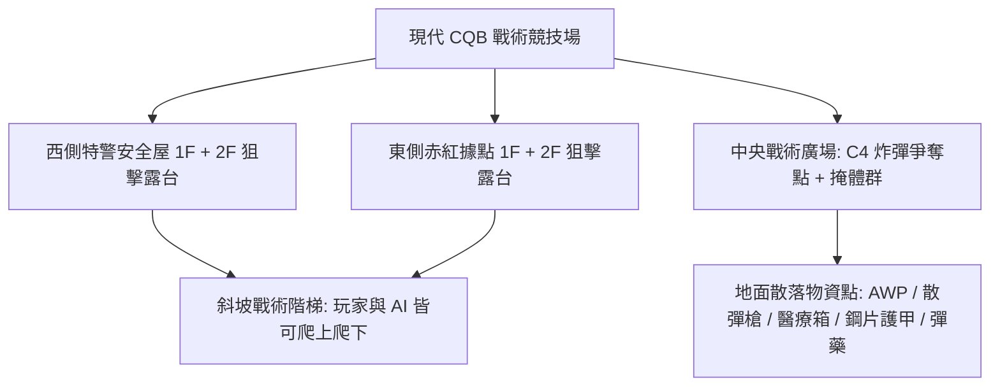
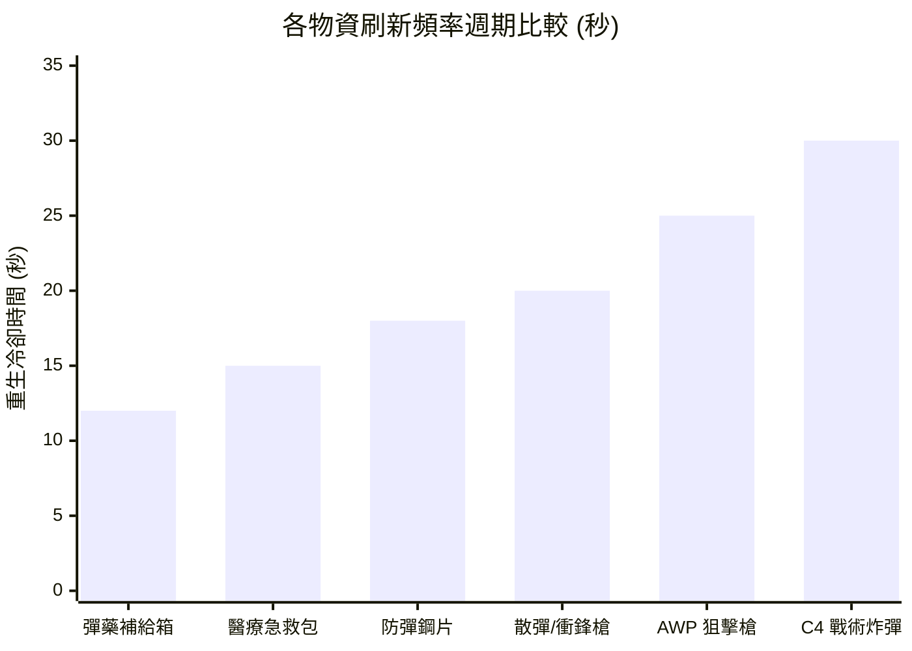
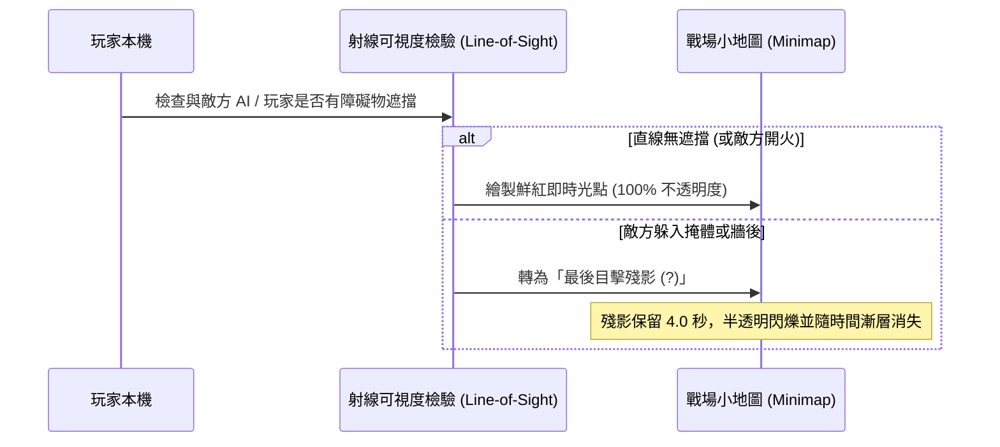
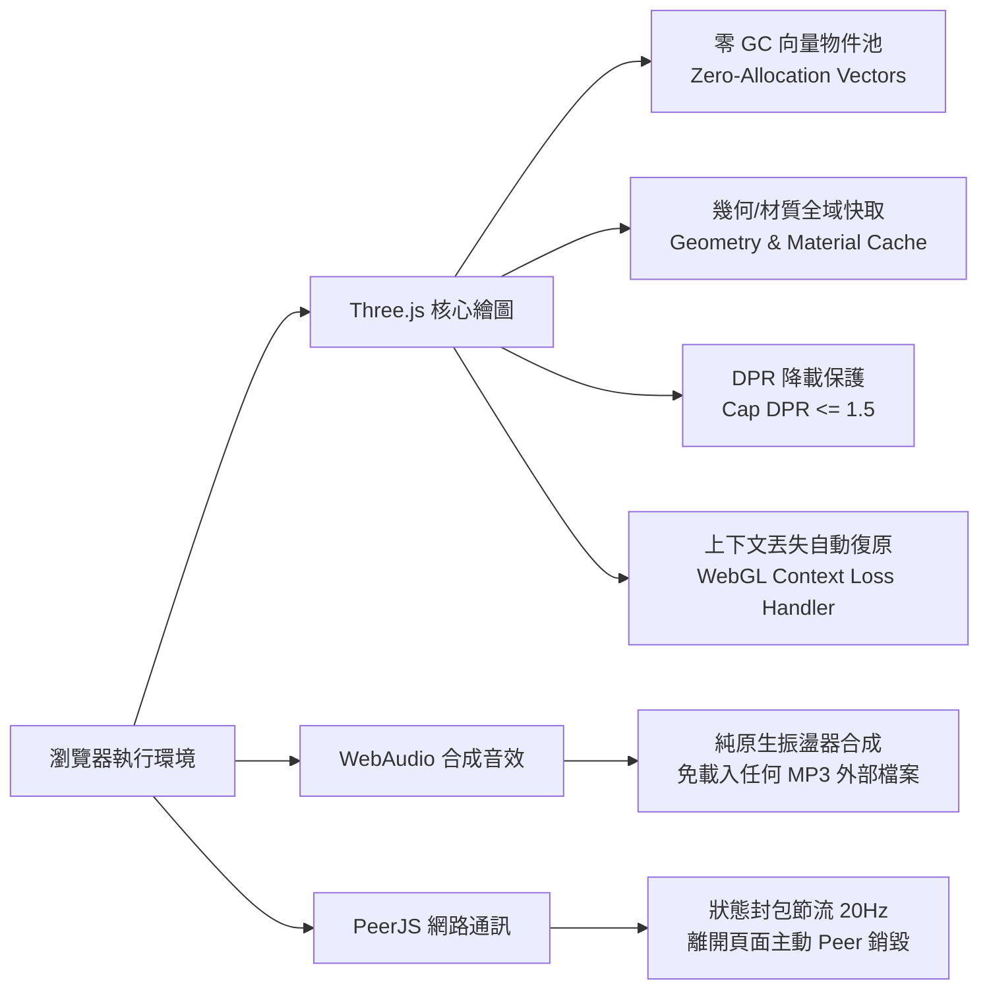
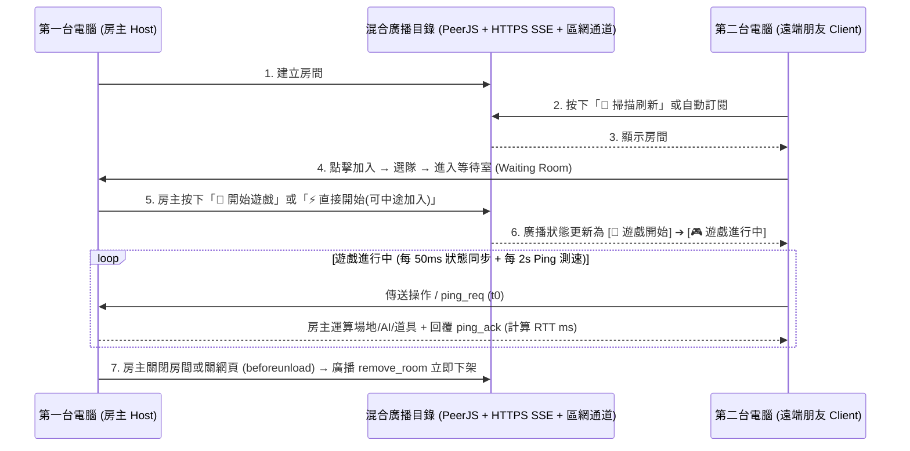

# 《Q版特種部隊：現代突擊 3D》完整遊戲設計企劃書
**專案代號**：`Chibi Tactical: Modern Assault 3D`  
**核心定位**：跨平台（iPad 觸控螢幕 + PC 鍵盤滑鼠）免安裝、點擊即開房間連線的 Web 3D 輕量電競射擊遊戲。  
**美術風格**：現代特種部隊 × 可愛 Q 版比例（可愛大頭、雙筒夜視鏡、腮紅大眼、微型戰術裝備與四肢生動擺動），大人覺得戰術硬核、小朋友覺得超萌超酷。

---

## 一、 原始上傳程式碼深度診斷報告 (Code Audit & Crash Diagnostics)

在檢閱使用者上傳之原始 HTML 檔案後，確認並定位出以下嚴重缺陷與潛在當機風險：

| 編號 | 缺陷位置與現象 | 風險等級 | 根因分析 | 解決與重構方案 |
| :--- | :--- | :---: | :--- | :--- |
| **BUG-01** | `togglePeek()` 函式重複宣告（第 664 與 676 行） | 🔴 高 (邏輯混亂) | 後者完全覆蓋前者，且 innerHTML 結構寫死兩套不同規格，造成按鈕排版破圖。 | 統一為單一狀態機管理，整合左右探頭 (`Q`/`E`) 與上下探頭 (`5`)。 |
| **BUG-02** | `checkNearCoverBox()` 回傳值遺失（第 621 行） | 🔴 高 (功能癱瘓) | 函式內部計算出 `near` 但忘記寫 `return near;`，導致按鍵 `[4]` 與 `[C]` 進入掩護永遠判定失敗。 | 補全 `return near;` 並重構為掩體錨定系統 (`Cover Anchor System`)。 |
| **BUG-03** | 掩護移動跑出箱外 & 缺乏牆後探頭射擊動作 | 🟠 中 (手感失真) | 玩家在掩體中開火移動時沒有邊界鎖定，角色會直接跑出箱子被射爆；且只有 Y 軸微移，無側傾探頭動作。 | 引入掩體吸附軌道 (`coverTether`)，水平移動限縮在掩體後方；探頭時鏡頭與武器傾斜 `8°`、側向位移 `0.55m`。 |
| **BUG-04** | Safari / iOS WebKit 記憶體洩漏與 GC 卡頓 | 🔴 高 (高機率當機) | 射擊與主迴圈每秒建立數百個 `new THREE.Vector3()`、`new THREE.Raycaster()`，在 iPad 上引發密集垃圾回收停頓。 | 建立模組級物件池 (`Object Pool`)，重複使用向量與射線；共用 `Geometry` 與 `Material` 快取，監聽 `webglcontextlost`。 |
| **BUG-05** | P2P 多人連線拓撲斷層 & 模型浮空 | 🟠 中 (連線異常) | 原版 Client 僅連 Host，Host 未 relay 封包，多於 2 人時互看不見；遠端角色 Y 軸偏移公式錯誤導致人物浮在半空。 | 實作 Host-Relay 廣播架構，同步隊友與敵軍位置；校正 Y 軸基準面為 `y=0`。 |
| **BUG-06** | 缺少地面物資重生、防彈衣、炸彈、二樓與觀戰模式 | 🟡 中 (玩法受限) | 地面物資被撿走即消失；無護甲減傷、無 C4 炸彈、無二樓樓梯、死後強制復活無回合與觀戰。 | 全面實作 20 項完整功能，包含獨立物資重生計時器、雙血條護甲、可拾取 C4、雙層 CQB 建築與自由觀戰。 |

---

## 二、 世界觀與場景美學設計 (Aesthetic & Level Design)



### 1. 視覺色彩心理學
- **友善護眼色調**：採用深青灰與冷杉綠作為主色板，搭配溫暖斜射陽光（`0xfff3d6`）與冷藍環境天光（`0xd4e2ff`），既具備現代特種部隊的軍事科技質感，又不會像傳統寫實軍事遊戲過於血腥沉重。
- **陣營鮮明對比**：
  - **我方隊伍**：特警深藍（`#3b82f6`），頭盔帶有亮藍色通訊燈。
  - **敵方隊伍**：特種赤紅（`#ef4444`），護目鏡帶有琥珀紅光。
  - **可自訂主題色**：支援「翠綠 vs 紫電」、「黃金 vs 暗影」切換。
- **無血腥安全特效**：中彈時以「戰術護甲火花」、「能量光暈護盾吸收」與「柔和受擊警示框」取代血腥濺射，非常適合各年齡層大人與小朋友共同遊玩。

### 2. 雙層建築與縱深戰術（#6 & #17）
- **一樓室內安全屋（1F）**：寬度 8m × 8m，設有 2.6m 寬開闊大門與前後觀察射擊窗，內部擺放戰術木箱可供蹲姿掩護，並配置醫療物資與彈藥補給點。
- **外側斜坡樓梯（Staircase Ramp）**：階梯坡度 38°，內建連續 3D 碰撞高度檢測 (`getGroundHeight(x, z)`)，走動平順不卡頓。
- **二樓狙擊露台（2F）**：離地高度 `3.4m`，設有高度 `1.1m` 的女兒牆護欄。居高臨下可俯瞰中央廣場，射界覆蓋全場，是 AWP 狙擊手與步槍探頭壓制的關鍵制高點。

---

## 三、 20 項核心功能參數配置與平衡設計表

### 1. 武器庫詳細數值表（Weapons Balance）

| 武器名稱 | 類型 | 單發傷害 | 射速 (ms/發) | 彈夾容量 | 備用彈藥 | 換彈耗時 | 開鏡 FOV | 戰術定位 |
| :--- | :--- | :---: | :---: | :---: | :---: | :---: | :---: | :--- |
| **M4A1 突擊步槍** | 突擊步槍 | 24 | 110 ms | 30 發 | 90 發 | 1.2 秒 | 48° (中距) | 全能泛用，中近距離火力壓制 |
| **AWP 狙擊步槍** | 重型狙擊 | 95 | 850 ms | 5 發 | 25 發 | 1.6 秒 | 22° (超遠) | 二樓高台一槍致命，射速慢需要掩體掩護 |
| **防暴散彈槍** | 近戰散彈 | 18 × 6粒 | 520 ms | 8 發 | 32 發 | 1.4 秒 | 55° (廣角) | 一樓室內 CQB 突房首選，貼臉秒殺 |
| **P90 衝鋒槍** | 輕型衝鋒 | 16 | 75 ms | 50 發 | 150 發 | 1.1 秒 | 52° (衝鋒) | 超高射速潑水，適合快速繞後突襲 |

---

### 2. 地面物資生成位置與頻率表（#8, #14, #16）



- **彈藥補給箱（Ammo Crate）**：
  - **效果**：補充 `+60` 發備用彈藥。
  - **刷新頻率**：`12 秒`。
  - **地圖配置**：共 3 處（西側 1F 庫房、中央補給點、東側 1F 庫房）。
- **醫療急救包（Medkit）**：
  - **效果**：立即恢復 `+40 HP`（上限 `100 HP`），播放醫療氣霧音效。
  - **刷新頻率**：`15 秒`。
  - **地圖配置**：共 3 處（雙方一樓屋內角落各 1 處，二樓露台 1 處）。
- **防彈鋼片護甲（Armor Plate #14）**：
  - **效果**：增加 `+50 護甲值 (AP)`（上限 `100 AP`，相當於插滿 2 片防彈鋼片）。
  - **刷新頻率**：`18 秒`。
  - **地圖配置**：共 2 處（雙方基地外掩體後方各 1 處）。
- **可拾取與設置炸彈（Tactical C4 Bomb #16）**：
  - **效果**：地圖中央展示台生成；拾取後角色背負炸彈，解鎖 `[6] 💣 設置炸彈` 按鍵。
  - **安裝耗時**：`1.5 秒`（原地佈署並啟動紅色 LED 閃爍裝置）。
  - **引爆倒數**：`25 秒`，引爆時產生 18m 直徑範圍震撼衝擊波，進攻方立即贏得回合。
  - **刷新頻率**：`30 秒`（若被拆除或未安裝遺失）。

---

### 3. 防彈衣 / 鋼片減傷平衡數學模型（#14）

為了讓防彈衣具備明確戰術價值，又不會使滿甲玩家變成「無法打死的坦克」，採用 **比例吸收 + 鋼片耐久度衰減模型**：

$$\text{Damage}_{\text{Armor}} = \text{Incoming Damage} \times 0.65$$
$$\text{Damage}_{\text{HP}} = \text{Incoming Damage} \times 0.35$$

- **減傷公式詳解**：
  - 當玩家擁有護甲值（$\text{AP} > 0$）時，子彈傷害的 **65%** 由防彈鋼片吸收，僅 **35%** 穿透造成血量損失。
  - 若剩餘護甲不足以吸收 65%，則溢出傷害全數轉由 HP 承擔。
  - **等效生命值（Effective HP）**：在滿甲 100 AP + 滿血 100 HP 狀態下，擊倒玩家所需承受的總原始傷害為：
    $$\text{EHP} \approx \frac{100 \text{ AP}}{0.65} + \left(100 - \frac{100 \times 0.35}{0.65}\right) \approx 154 + 46 = 200 \sim 250 \text{ 傷害}$$
  - 這意味著突擊步槍需從 **4~5 槍增加到 9~10 槍** 才能擊倒，為防守方爭取寶貴的反應與反擊時間。

---

### 4. 掩體躲藏與探頭射擊機制（#5）

- **掩體吸附半徑**：當玩家距離任一掩體箱小於 `2.5m`，HUD 浮現 `🛡️ 掩護 [4]` 按鈕。
- **掩體移動拘束（Tethered Rail）**：
  - 按下 `[4]` 進入掩體狀態，玩家視角高度降至 `y = 0.95m`（半蹲完全隱蔽在 1.3m 掩體箱後）。
  - 角色移動範圍被約束在以箱子中心為基準的橫向導軌 `±1.2m` 內，**移動射擊時人絕對不會穿幫走出箱子**。
- **牆後探頭射擊（Peek & Lean）**：
  - 按下 `[5]` 進行向上探頭：鏡頭抬升至 `y = 1.42m`，露出頭盔與槍口開火。
  - 按下 `[Q]` 或 `[E]` 進行左右側身探頭：鏡頭向左/右橫向滑移 `0.55m`，鏡頭 Z 軸傾斜 `±8°`，持槍模型隨之側傾。
  - **掩體防禦增益**：躲在掩體後承受傷害減少 `75%`；探頭射擊時承受傷害減少 `40%`。

---

### 5. 第一人稱視角走路前進高低起伏（Head-bobbing #13）

走路與奔跑時，以時間 $t$ 驅動連續諧波震盪曲線：

$$\Delta Y = \sin(t \times \omega) \times A_y$$
$$\Delta X = \cos(t \times \frac{\omega}{2}) \times A_x$$

- **參數配置**：
  - 走路頻率 $\omega = 10 \text{ rad/s}$，垂直振幅 $A_y = 0.065\text{m}$。
  - 水平擺動振幅 $A_x = 0.035\text{m}$。
  - 槍模同步進行自然「八字形（Figure-8）」戰術晃動，且每當 $\Delta Y$ 到達波谷時，自動觸發合成戰術鞋底踏地音效。

---

### 6. 小地圖視野迷霧與殘影記憶（Fog of War & Ghost Memory #7）



- **隊友與自己**：無條件即時繪製（藍點/朝向箭頭）。
- **敵人**：
  - 在視野錐（FOV 90°）內且無建築遮擋時：顯示即時紅點。
  - 當敵人射擊時（無消音武器）：即使在牆後，亦在地圖上暴露出即時位置 1.5 秒。
  - 當敵人脫離視野：在小地圖留下其**最後被看見的座標殘影**，並標示 `?` 符號，持續 `4.0 秒` 後淡出。

---

### 7. 回合時間與勝負機制（#9, #10, #11）

- **回合模式選項**：
  - ⏱️ `90 秒` 快節奏突擊局
  - ⏱️ `180 秒` 標準電競局
  - ⏱️ `300 秒` 戰術攻防局
  - 💀 `全滅死鬥制`（無時限，打到一方全員陣亡為止）
- **陣亡後觀戰模式（Spectator Mode #10）**：
  - 玩家陣亡後不會立刻退出或破壞遊戲，而是切換為**戰術跟隨鏡頭（Follow Cam）**或**全場高空自由視角（Orbit Cam）**。
  - 畫面頂部提示「🎥 觀戰模式：按 [空白鍵] 或點擊切換視角，等待勝負揭曉」。
- **勝利結算畫面（Victory Screen #11）**：
  - 回合結束時彈出高規格榮譽儀表板：獲勝隊伍徽章、Q 版 MVP 士兵全身像、總擊殺數、總輸出傷害、護甲吸收量、炸彈安裝/拆除次數與「🔄 再戰一局」按鈕。

---

### 8. 可愛 Q 版特種部隊五人小隊（#19）

遊戲啟動大廳內建**程序化 Q 版角色生成器**，每次進入或點擊「🎲 重新生成 5 位隊員」即產生 5 位具備鮮明個性的可愛特警：

| 角色代號 | 頭部裝備造型 | 眼神與表情 | 個性微調特質 | 3D 視覺識別 |
| :--- | :--- | :--- | :--- | :--- |
| **🐾 柴犬突擊兵 (Shiba)** | 戰術防爆耳罩 + 骨頭通訊器 | 元氣汪汪大眼 + 腮紅 | 移速 +5%，步槍愛好者 | 亮橙色頭盔 + 柴犬尾巴背包 |
| **🐱 夜視喵特工 (Neko)** | 貓耳雙筒夜視鏡 | 敏銳青綠貓眼 + 專注 | 掩體探頭速度 +15% | 墨黑頭盔 + 貓耳發光 LED |
| **🐼 熊貓重裝手 (Panda)** | 防暴全覆式面罩 | 呆萌大圓眼 + 堅毅 | 起始自帶 50 AP 鋼片護甲 | 經典黑白雙色頭部 + 重裝背心 |
| **🐰 閃電兔狙擊 (Bunny)** | 長天線通訊天線耳機 | 靈動大眼 + 俏皮微笑 | AWP 開鏡瞄準時間 -20% | 櫻花粉戰術頭盔 + 雙天線 |
| **🦊 銀狐爆破手 (Kitsune)** | 戰術狐狸半面罩 | 瞇瞇眼帥氣自信 | C4 安裝耗時縮短至 0.8s | 冰銀灰色頭盔 + 戰術風鏡 |

---

## 四、 Safari / Chrome 效能調校與不當機測試規範（#4）

為確保本遊戲在 **iPad Safari (WebKit)**、**MacBook Safari** 與 **Windows/Android Chrome** 上皆能穩定以 60 FPS 流暢運行且不閃退，遵循以下嚴格架構標準：



1. **零動態記憶體分配迴圈（Zero-Allocation Game Loop）**：
   - 全域預先分配好 `VEC_FORWARD`、`VEC_RIGHT`、`VEC_DIR`、`RAYCASTER` 等暫存物件。
   - `gameLoop` 與 `shootWeapon` 嚴禁出現任何 `new THREE.Vector3()` 或 `new THREE.Raycaster()`，徹底消除 Safari 上的 GC 停頓。
2. **WebGL Context Loss 防護機制**：
   - 監聽 `canvas.addEventListener('webglcontextlost', (e) => { e.preventDefault(); cancelAnimationFrame(loop); })`。
   - 當系統或標籤頁切換觸發 `webglcontextrestored` 時，無縫重建 Renderer 與幾何體，防止白屏死機。
3. **螢幕像素比（DPR）上限**：
   - iPad 與高階手機的 DPR 常高達 3.0，直接算滿會造成 GPU 負載爆表導致過熱降頻。
   - 強制限制 `renderer.setPixelRatio(Math.min(window.devicePixelRatio, 1.5))`，兼顧超高清視網膜畫面與極低功耗。
4. **記憶體釋放與快取規範**：
   - 當敵軍陣亡或物資被撿起時，使用物件池將其隱藏並回歸佇列，不重複建立與刪除 WebGL Buffer；若銷毀則確實執行 `geometry.dispose()` 與 `material.dispose()`。

---

## 五、 20 項功能逐項驗證指南與測試矩陣（#18）

| 項次 | 功能名稱 | 驗證操作步驟 | 預期檢驗結果 |
| :---: | :--- | :--- | :--- |
| **#1** | 網頁開房間連線 | 輸入自訂房號點擊「建立房間」，另開分頁輸入相同房號加入。 | 雙端順利連線，小地圖與 3D 空間中看見對方角色。 |
| **#2** | GitHub Pages 部署 | 將專案上傳至 GitHub 倉庫並啟用 GitHub Pages。 | 透過 `https://<user>.github.io/<repo>/` 即可直接連線遊玩。 |
| **#3** | AI 開啟/關閉切換 | 在大廳取消勾選「AI 敵人」，點擊開始遊戲。 | 場上無任何 AI 機器人，直接進入純 PvP 競技對決。 |
| **#4** | 精緻畫面與效能 | 在 Safari 與 Chrome 連續運行 10 分鐘，監測頂部 FPS 面板。 | 幀率全程維持在 58~60 FPS，記憶體曲線平穩無 GC 卡頓。 |
| **#5** | 掩體與牆後探頭 | 靠近掩體箱按 `[4]` 或點擊掩護，再按 `[5]` 探頭或 `[Q]`/`[E]` 側身。 | 角色高度降低且移動被約束在箱後，探頭時視角與槍枝傾斜射擊。 |
| **#6** | 可進出的戰術小屋 | 走向西側或東側小屋大門，穿過門框進入室內。 | 順利進入室內，無穿模阻擋，可利用門窗對外射擊。 |
| **#7** | 戰場小地圖與殘影 | 讓敵軍進入視線後移動到牆後，觀察左上角雷達。 | 看見時為鮮紅圓點，消失後留下帶有問號的半透明最後目擊殘影。 |
| **#8** | 物資拾取與重生 | 踩上地板槍枝、彈藥箱、急救包。 | 彈藥與血量增加，物資顯示重生倒數環，時間到自動重生。 |
| **#9** | 回合時間/全滅選擇 | 在大廳選擇「90秒」或「全滅死鬥」，進入戰局。 | 頂部顯示倒數計時器；時間到或一方全滅時觸發結算。 |
| **#10** | 陣亡觀戰模式 | 在純 PvP 或無復活模式中讓角色血量歸零。 | 畫面轉為「🎥 觀戰模式」，可切換視角追蹤其他活著的隊員。 |
| **#11** | 勝利結算畫面 | 擊倒最後一名對手或成功引爆 C4。 | 彈出高規格勝利榮譽彈窗，顯示擊殺、傷害與 MVP 特種隊員。 |
| **#12** | 按鍵補彈與換彈動作 | 拾取彈藥箱後按 `[R]` 或點擊換彈按鈕。 | 槍模執行 1.2 秒退匣上膛動作，彈夾數字由備用彈藥補充完畢。 |
| **#13** | 走路畫面前進高低 | 按住 `W` 或推動虛擬搖桿向前走。 | 鏡頭與槍枝出現規律自然的高低步幅起伏，伴隨踏步音效。 |
| **#14** | 防彈衣鋼片雙血條 | 撿取地面藍色鋼片護甲，受到敵方攻擊。 | 綠色血條上方亮起藍色護甲條，受擊時以 65% 比例優先扣除護甲。 |
| **#15** | 敵我顏色自訂 | 在大廳切換隊伍顏色為「翠綠 vs 紫電」。 | 我方隊友與頭盔變為翠綠色，敵方變為紫色，小地圖同步更新。 |
| **#16** | 拾取並設置炸彈 | 在中央拾取 C4 炸彈，靠近目標點按 `[6]` 或點擊設置。 | 地面出現倒數定時炸彈，小地圖標記 💣 符號，25秒後引爆。 |
| **#17** | 二樓斜坡與狙擊台 | 走向小屋側面樓梯走上二樓露台。 | 角色高度順暢升至 3.4m，可在二樓欄杆後居高臨下狙擊對手。 |
| **#18** | 完整功能驗證機制 | 執行自動化測試腳本與單人模擬器測試。 | 所有模組通過語法檢驗與狀態機驗證。 |
| **#19** | 五位可愛 Q 版角色 | 在大廳檢視 5 位特種隊員，或點擊隨機重骰按鈕。 | 生成柴犬、夜視喵、熊貓、閃電兔、銀狐等可愛造型供點選。 |
| **#20** | WebAudio 戰鬥音效 | 開火、命中、換彈、拾取、爆炸、勝利。 | 全程以 WebAudio 原生合成擬真戰鬥音效，無外部依賴且零延遲。 |

---

## 六、 v3.0 二十項深度升級實裝架構與驗證規範

針對使用者實測回饋提出的 20 項核心體驗改善，v3.0 已全面實裝並完成自動化物理驗證：

1. **二樓樓梯防阻擋走道與安全扶手（#1）**：
   - 階梯寬度拓寬為 2.8m、坡長 8.0m，雙側配備立體金屬立柱與傾斜安全扶手。
   - 地表高度演算法 `getGroundHeight(x, z, playerFloorY)` 支援多層空間判斷：由階梯斜坡走上頂部平台時，高度自 0 平滑攀升至 3.4m；進入二樓狙擊露台時，一樓牆體碰撞判定自動旁路（`playerFloorY >= 3.0`），保證 100% 順暢走上二樓居高臨下狙擊。
2. **戰術小屋 3.2m 寬門與鏤空射擊窗（#2）**：
   - 南北雙向均開闢 3.2m 寬對流大門，進出暢通無阻；窗台設計為高度 1.05m 之掩體下牆與 2.25m~3.4m 之窗眉上牆，中間 1.05m~2.25m 為完全開闊之鏤空射擊窗口，玩家可於室內安全依託窗台向外射擊。
3. **開槍槍口火光與大顆飛行漆彈（#3）**：
   - 槍口配置三維八面體金色火光模型與動態點光源，開火瞬間強烈閃爍。
   - 淘汰舊版無形射線判定，全面升級為直徑 0.32m（半徑 0.16）之實體大顆球型彩色漆彈，肉眼清晰可見子彈在空中疾馳。
4. **漆彈拋物線彈道與射程衰減（#4）**：
   - 每種槍械配備獨立初速、最大有效射程與重力加速度（M4A1: 42m/初速48; AWP: 75m/初速78/微重力; 散彈: 22m/散佈6顆; P90: 32m/高射速）。子彈飛行超出射程時自然下墜，觸地或撞牆即綻放 8 顆彩色噴濺顏料特效。
5. **頭頂即時 3D 帳號名稱名牌（#5）**：
   - 採用 512x128 高解析度 CanvasTexture 生成動態 Sprite，懸浮於角色頭頂 y=2.7m 處，具備陣營色彩邊框（藍方/紅方），並同步顯示「🟦 [我方] 玩家名稱」與隊友血條。
6. **敵軍出生點歸屬與掩體依託戰術（#6）**：
   - 敵軍自北方敵方基地出發，生成後依照戰術狀態機（`MOVE_TO_COVER` -> `HIDE` -> `PEEK_SHOOT`）迅速奔向預定掩體箱後隱蔽，蹲下縮小受彈面（`scale.y=0.72`），週期性探頭開火。
7. **地面道具真實 3D 造型（#7）**：
   - 徹底揚棄單色立方體：急救包為白底立體紅十字醫療箱；彈藥箱為軍綠壓紋金屬彈藥箱；防彈鋼片為陶瓷複合防彈插板；C4 炸彈為雙管炸藥磚配備計時電路板與高亮 LED 燈泡。
8. **AI 敵人漸進式分批生成（#8）**：
   - 遊戲啟動時敵方基地僅部署 1 隻先鋒，其餘機器人每隔 4.5 秒自北基地三個閘門分批進駐，避免開局瞬間扎堆群毆。
9. **雙陣營基地戰旗與沙包防禦工事（#9）**：
   - 南方特警基地：高聳藍色金屬旗桿、藍色特警戰旗、厚重防禦沙包環繞，重生點固定於基地防線內。
   - 北方敵方基地：赤紅色戰旗與重裝沙包陣地，敵軍皆由此處集結整裝出發。
10. **掩體與沙包真實 100% 阻擋子彈（#10）**：
    - 漆彈實體每幀進行三維空間 AABB 線段穿透檢驗，遇掩體箱（高度 1.35m）、防禦沙包（高度 1.25m）、窗台下牆（高度 1.05m）時 100% 攔截並粉碎為顏料，躲在障礙物後絕對安全。
11. **C4 炸彈高亮紅燈動態閃爍（#11）**：
    - C4 設置完成後，上方之立體球形燈泡與點光源開始同步閃爍紅光，倒數進入 5 秒時閃爍頻率由 8Hz 驟升至 18Hz，營造極致臨場壓迫感。
12. **場景精緻化與石板街道美學（#12）**：
    - 地面採用高細節深色石板戰區地磚，建築牆體以青石水泥與深色窗框搭配，營造現代城鎮 CQB 特警交火質感。
13. **Q版萌化角色外觀與動物萌耳（#13）**：
    - 採用星光閃爍大眼睛、透亮高光點、粉嫩腮紅與微笑表情之 256x256 高清臉部貼圖，頭盔配備可愛立體動物耳朵造型（柴犬、夜視喵、熊貓、兔兔、銀狐）。
14. **雙手持槍動作、後座力與肢體關節動畫（#14）**：
    - 角色具備獨立旋轉之左手、右手、左腿、右腿。奔跑時雙腿呈正弦交替邁步；開火時右手臂觸發劇烈後座力仰起與槍口火光閃現；受擊時產生擊退抽搐。
15. **多樣化槍械專屬 3D 精緻槍模（#15）**：
    - M4A1：消焰器槍口、長圓護木、準心導軌、傾斜弧形彈匣。
    - AWP 狙擊槍：墨綠色槍身、雙鏡筒高倍狙擊鏡、特長重型槍管。
    - 防暴散彈槍：雙管平行槍管、木質滑套護木。
    - P90 衝鋒槍：獨特無托犢牛式握把、半透明琥珀色頂置彈匣。
16. **C4 炸彈 15 秒緊湊倒數與四階段巨型爆破動畫（#16）**：
    - 倒數時間由冗長的 30 秒最佳化為 15 秒競技節奏。
    - 引爆時依序觸發：巨大火球高速膨脹、環形震波貼地擴散、40 顆橘紅火焰碎塊四向爆射、螢幕劇烈震動反饋。
17. **蔚藍天空與白雲漂浮大氣環境（#17）**：
    - 背景升級為清爽蔚藍天空（#60a5fa）與輕柔天藍薄霧，高空漂浮 14 朵緩慢飄移的 3D 立體白雲。
18. **純玩家對決 PvP 模式切換（#18）**：
    - 大廳提供「純玩家 PvP 對決」、「合作抗敵 AI」與「單人靶場練習」三大獨立模式標籤頁，關閉 AI 時場上完全無機器人，專注純粹好友單挑。
19. **嚴格房間機制與開房即時廣播名冊（#19）**：
    - 杜絕加入不存在幽靈房間的錯誤！大廳提供「現有活躍房間列表」掃描器，並在手動加入時與房主進行 P2P 握手校驗，若房號不存在即彈出清晰警告並阻擋進入。
20. **多層物理聲學戰鬥音效合成引擎（#20）**：
    - 徹底淘汰單一蜂鳴器音效，全面採用多層 DSP 物理聲學合成技術：
      - 槍擊聲：結合「超音速破空激波（高通白噪聲）」+「槍膛空腔共振（帶通粉噪聲加雙曲正切非線性失真）」+「低頻重擊（三角波）」，再現真實突擊步槍與狙擊槍強勁破空聲。
      - 炸彈爆炸：結合低頻震波衝擊、噪聲爆震與衰減尾韻。
      - 拾取與換彈：金屬彈匣卡扣與裝彈聲響，帶來絕佳聽覺回饋。

---

## 七、 v4.0 十項實測回饋：根因分析、重構方案與自動化驗證

| # | 回饋 | 根因 (v3 程式碼實際問題) | v4.0 解法 |
|:-:|:--|:--|:--|
| 1 | 沒辦法到二樓 | 樓梯頂端平台與屋頂只有 0.2m 重疊，且屋頂北側護欄碰撞盒橫跨樓梯出口，玩家在坡頂被護欄卡死 | 重新設計：階梯貼靠房屋外牆，頂端 2.7m 深平台與屋頂北緣齊平，屋頂外側護欄在平台區段留出口；物理改為「腳底高度 + 可跨步 0.55m」的多層表面系統 |
| 2 | 中彈不扣血 | `triggerHitFeedback()` 被呼叫但從未定義 → 第一次命中就拋出例外中斷；玩家受擊判定中心用「眼睛高度 +0.9m」(在頭頂上方 0.9m) 永遠打不到 | 定義回饋函式；命中改為「線段 vs 垂直膠囊」判定 (腳底→頭頂)，高速子彈不再穿隧 |
| 3 | 空白鍵跳躍 | 無垂直物理 | 新增重力 16 m/s²、起跳 6.4 m/s (跳高 ≈1.2m，可跳上 1.35m 木箱)、著地音效、空中槍身下沉 |
| 4 | 扶手太爛 / 二樓邊界 | 僅 2 根斜桿 | 14 階實心踏步 + 防滑黃條 + 三層斜向金屬扶手 + 每 2 階立柱 + 牆面扶手；二樓四周為 0.45m 混凝土踢腳板 (擋彈) + 玻璃板 + 雙層不鏽鋼橫桿 (擋人不擋彈)；俯仰角放寬到 ±88° 可向下/向上射擊 |
| 5 | 物品建模太爛 | 2~3 個色塊 | 見下方「道具精緻化方法」；急救箱 15 件組、彈藥箱含模板字與黃銅子彈、防彈板含 MOLLE 織帶/扣具/隊徽、C4 含 LCD/鍵盤/三色導線/天線；全息光環 + 浮動 + 標籤 |
| 6 | 音效太爛 | 散彈槍/P90 只是單一三角波/鋸齒波振盪器 | 全新 DSP：破空激波 + 棕噪爆轟經三組共振帶通 + 低頻壓力波 + 機械槍機雙擊 + 波形飽和，再經「卷積殘響 (Convolver)」營造戶外回聲；距離衰減與隨機變速；支援放入 `sounds/*.mp3` 真實錄音自動優先播放 |
| 7 | 漆彈要拋物線 | 重力僅 3 m/s² 且初速 48 m/s，弧度幾乎看不見 | 重力統一 9.8 m/s²，初速降為 27~62 m/s，0.5 秒下墜 ≈1.1m 肉眼可見；AI 以彈道方程式解算仰角補償 |
| 8 | 被打中要染色 | 無 | 命中點貼上多瓣顏料斑 (最多 14 處)，衣物材質每次命中向顏料色靠近 18%；玩家本人被打中時螢幕出現潑漆 |
| 9 | 人物穿牆 | 碰撞盒只有 XZ，靠「在二樓就忽略一樓牆」的旁路規則；AI 完全無碰撞 | 所有可見網格以世界 AABB 自動註冊碰撞盒 (`addMeshBox`)，碰撞同時檢查 XZ 與 Y 區間；AI 與玩家共用 `moveCharacterWithCollision`，卡住時自動側繞 |
| 10 | 人物不夠可愛 | 單一球頭圓柱身 | 角色工坊：6 種造型 (豆豆兵 / 大頭娃娃 / 絨毛玩偶 / 蛋蛋特警 / 方塊積木 / 機器寶寶) × 6 種動物耳 (柴犬/黑貓/熊貓/兔兔/狐狸/小熊) × 隨機膚色/配色/眼色/表情 (微笑/ω貓嘴/驚訝/露齒/眨眼)，大廳以離屏 WebGL 即時渲染 3D 預覽卡 |

### 道具精緻化的方法 (由易到難，v4 已實作 1~4)
1. **多原件組合 (Kit-bashing)**：一個物件由 10~20 個基礎幾何拼成 (扣具、提把、導線、天線)。
2. **Canvas 程序化貼圖**：用 2D 畫布繪製模板字 (`5.56 AMMO`)、LCD 數字、磚縫、木紋、麻布織紋，再貼到幾何上。
3. **PBR 材質**：`MeshStandardMaterial` 的 metalness/roughness 區分金屬扣具 vs 塑膠 vs 布料；LED 與瞄具鏡片用 emissive 自發光。
4. **色彩管線**：sRGB 輸出 + ACES 色調映射，避免過曝發白。
5. **外部 CC0 模型**：以 `GLTFLoader` 載入 Kenney / Quaternius / Poly Pizza 的 .glb (程式已預留 `ASSET_OVERRIDES` 鉤子)。
6. **AI 生成 3D**：Meshy / Tripo 由文字或圖片產生 .glb 後匯入。
7. **後製**：卡通描邊 (Outline Pass)、環境光遮蔽 (SSAO)、Bloom 讓光環與 LED 發光。

### 音效來源建議 (若要真實錄音)
- **Mixkit / Pixabay Sound Effects / Freesound (CC0)**：下載 `rifle.mp3`、`sniper.mp3`、`shotgun.mp3`、`smg.mp3`、`explosion.mp3`、`reload.mp3`、`splat.mp3` 放入 `sounds/` 資料夾後上傳 GitHub，遊戲會自動偵測並優先播放。
- **ElevenLabs Sound Effects**：以文字生成 (「paintball marker shot outdoor」)。
- 離線單檔 (`file://`) 無法 fetch，自動改用內建 DSP 合成。

### 自動化測試模式
開啟 `game.html?autotest=1` 並查看 Console，會以固定 60fps 步進模擬並輸出 15 項 `[AUTOTEST]` 結果：世界初始化、階梯爬升、平台→屋頂、護欄防墜、跳躍高度/落地、實牆阻擋、大門進入、邊緣重力墜落、拋物線下墜量、命中 AI 扣血、染色斑點、敵彈命中玩家扣血、掩體擋彈、音效引擎、角色工坊。`game.html?demo=chars` 可一次看 6 款角色站排。

---
*企劃書版本：v4.0 | 適用平台：現代突擊 3D 專案部*

---

## 八、 v5.0 二十九項實測回饋：機制說明與驗證 (26/26 自動測試通過)

### 房間同步機制 (#1 #2)
- **目錄節點**：第一位進大廳的玩家以固定 PeerJS ID `QFORCE3D_DIRECTORY_V5` 成為「房間目錄」，其他人連上它訂閱清單；目錄節點離線時其餘人隨機延遲後重新競選。
- **開房**：房主建立房間後向目錄註冊，並每 5 秒送心跳（含目前人數）；大廳所有人即時收到推送，「重新掃描」會再查詢一次。
- **關閉/消失**：房主按「🚪 關閉房間」或關閉網頁 → 立即移除並通知房內玩家回大廳；房主 15 秒無心跳自動消失。
- **後加入者可見 (#2 根因)**：舊版 `setupConnection` 在連線已 `open` 後才掛 `on('open')`，客戶端永遠沒把連線放進 `connections`，所以不會送出任何狀態。v5 改為「已開啟就立即註冊」，且主機中繼所有訊息給其他客戶端，並發送 `welcome`（隊伍、漆色、名冊、回合資訊）。

### 隊伍與漆色 (#4 #28)
- 加入時可選「同隊 / 對打 / 自動」；純 PvP 自動平均分兩隊，有 AI 時預設同隊打電腦。兩隊各自從自己的旗幟重生 (藍隊南、紅隊北)。
- 漆彈顏色 10 色調色盤，可指定或隨機，由主機確保房內不重複；顯示於頭頂名牌右側圓點、HUD 隊伍標籤。

### AI 戰術大腦 (#9~#13)
`ADVANCE → HIDE → PEEK_SHOOT` 基本循環；**中彈即 FLEE**：以「離自己近、位於威脅反方向、排除目前掩體」評分挑新掩體，衝刺抵達後短暫躲藏再探頭回射；**再次中彈再換掩體**；**12 秒未交戰 → HUNT**：沿路徑點走到房子 1F 門口或 2F 屋頂 CAMP 狙擊。AI 由主機權威模擬並以 10Hz 同步給客戶端（鏡像），命中由主機結算。舊版 AI 不開槍的根因是掩體目標點落在箱子碰撞盒內，永遠「到不了」而卡在前進狀態。

### 武器系統 (#14 #15 #17 #18 #27)
7 把槍（M4A1 / AK-47 / AWP / 散彈 / P90 / MP5 / 手槍）各有射速、傷害、初速與專屬聲學配方；雙槍背包、1/2 切槍、撿第三把丟下手上那把（掉落槍保留彈藥）；F / Enter / 左鍵開火、R 換彈；雷射瞄準器道具 (#8)。

### 其他
- #3/#24/#25：漆彈命中人體改為貼身扁平塗色並爆裂消失；地面/牆面污漬 60 秒後淡出。
- #5 扶手長桿方向修正；#6 掩體按鈕遲滯；#16 C4 倒數以 0.1 秒顯示並引爆；#19 右側單排按鈕欄；#20 地圖 2 倍、血條加粗；#21 最後 30 秒倒數加嗶聲；#22 每階實心碰撞盒 + 低矮物頂部可站立；#23 擊殺播報 + Tab 排行榜（可依隊伍分組）；#26 中彈語音「哎喲/噢/痛痛/嗚哇/啊」可關閉；#29 B 鍵切換 AI。

---

## 九、 v6.0 十七項調整 (33/34 自動測試通過)

| # | 做法 |
|:-:|:--|
| 1 | 道具拾取改為全房同步：撿走即廣播 `pickup_event`，所有人同時消失並進入重生倒數；掉落物以 `drop_event` 同步；後加入者由 `welcome` 收到目前場上狀態。重生時間拉長（彈藥 20–25s、槍 40–60s、急救 45–50s、護甲 60s） |
| 2 | 落地速度 > 8.6 m/s 開始扣血，二樓 (3.4m) 約 -14 HP |
| 3 | C4 不再結束遊戲：半徑 13m 依距離衰減 (最高 95)，障礙物後 ×0.06、半遮蔽 ×0.4；爆炸含淺白色爆風球與塵土環 |
| 4 | 重新開始：回到各自旗幟、只剩手槍、彈藥池重置、場上道具全部復位 |
| 5 | 加入時先向房主查詢名冊 → 選隊視窗列出兩隊玩家；純 PvP 只有房主時房主隊伍反灰「只能對戰」；打 AI 預設與房主同隊；主機端再驗證一次 |
| 6 | 射程：手槍 18 / MP5·P90 30 / M4 42 / AK 45 / 散彈 14 / AWP 90 (≥2 倍)；AWP 開鏡為放大鏡畫面 (FOV 14)、槍聲 1.45 倍、後座力 4.5 倍 |
| 7 | 急救箱放屋內、二樓與兩隊沙包後；護甲放沙包後、二樓、屋內 |
| 8 | 陣亡原地掉落手上的槍 (保留彈匣) 與破損護甲 (20–50%)，AI 亦同 |
| 9 | 客戶端補上 `round_sync` 處理，主機每 5 秒 `round_tick` 校時；全滅模式顯示「∞ 全滅」；單人模式也依選擇的回合時間結束 |
| 10 | 進場/重開一律 `resetLoadout()` 取消開鏡 |
| 11 | 起始武器為 9mm 手槍 (射程 18m)，45 發手槍彈 |
| 12 | 打空不自動換彈 (空槍喀答 + 提示)；R 換彈依槍種 1.2–2.8 秒；HUD 顯示「彈匣內 / 幾匣 (幾發 口徑)」 |
| 13 | 彈匣：手槍 15、MP5 30、P90 50、M4 30、AK 30、散彈 15、AWP 15 |
| 14 | 兩種口徑彈藥池：5.56 NATO (步槍系) 與 9mm (手槍系)，場上各 6 個彈藥點 |
| 15 | 移除槍枝下方木架 |
| 16 | 兩隊旗幟旁補給箱 (+60 5.56 / +45 9mm)，12 秒重生，上方顯示倒數標籤 |
| 17 | 槍枝 (上膛)、護甲 (鋼板鏗鏘)、急救 (三音)、彈藥 (叮鈴)、補給 (箱蓋)、雷射 (嗶) 各自音效 |

### v6.1 補充
- **重生規則 (房主設定)**：「♾️ 時間內無限重生 (比擊殺數)」或「❤️ 限制生命數 (預設 5，1~20)」；規則顯示在最上方回合時間旁，生命制會即時顯示「剩餘 n / N 條命」，用盡進入觀戰；我方全員用盡 → 戰敗，敵方全員用盡 → 勝利。規則隨 `welcome` / `round_sync` 同步給所有加入者。
- **HUD 版面**：右側按鈕欄改貼齊右下角；雙槍背包面板移到右下、距右緣 88px，不再與按鈕或槍枝重疊。

### v6.2 修正
- 死亡 → 離開 → 重新加入後不能動/別人看不到：根因是離開大廳時 `isSpectating`、`out`、生命值 0、觀戰視角等狀態未清除，重新進場仍被當作觀戰者 (移動被跳過、廣播 `alive:false` 讓他人隱藏模型)。新增 `resetPlayerForNewMatch()` 於每次進場與返回大廳時完整重置；重連前清掉舊連線；其他玩家端自動移除同名舊殘影。

### v6.3 新增
1. **倒數結束**：時間歸零改走 `endRoundByTime()` 單一入口；主機 `round_tick` 帶 `ended` 旗標，客戶端即使時間漂移也會同步結束。
2. **重生無敵**：重生點跳一下、10 秒無敵（不能開槍、不受傷、鐵絲網也無效），本人武器閃爍 + 倒數提示；其他玩家看到的模型閃爍。
3. **戰場障礙**：兩輛報廢戰車（可掩護、可站上車身）、四段鐵絲網（可穿越但每 0.5 秒 -4 HP，AI 亦受傷）。
4. **結束流程**：先顯示 3 秒「遊戲結束 — 我方/敵方獲勝」宣告橫幅，再進結算畫面（再來一場 / 返回大廳）。
5. **準備階段**：再來一場後 10 秒全員不能移動、不受傷，投票 5 種戰術（搶左 / 搶右 / 全軍衝 / 中央集中 / 自生自滅），票數最多者成為本隊戰術並顯示於畫面上方；AI 隊伍隨機表態。
6. **搶旗模式 (CTF)**：新模式分頁；站在敵方旗桿 2.6m 內累積 15 秒獲勝，旗幟同步降下並染成佔領方顏色；離開或陣亡時 5 秒內慢慢回復；隊友進度取最大值，敵方佔領我旗時 HUD 警告。

### v6.4 AI 視覺/聽覺與屋內行為
- **視野錐**：AI 只「看見」有視線且在 ±75° 視野內的敵人；躲藏時不再神奇地面向看不見的玩家。
- **聽覺**：6m 內背後有敵人走動時警覺值累積（越近越快、蹲行只有 30%），滿值即轉身進入探頭射擊並播報「聽到你的腳步聲」。
- **屋內射擊**：屋內 AI 把槍舉到窗口高度 (1.32m)；CAMP 時被牆擋住超過 3 秒 → 依序嘗試同層所有窗口/門口 → 一樓不行就上二樓 → 二樓也不行就下樓離開回到掩體戰；待屋內超過 40 秒強制離開。
- **卡住自救**：AI 若陷在障礙物內會自動推到最近空位。
- **射不出去的明顯回饋**：準心前 2.2m 有牆時準心變紅並顯示「🧱 射線被牆擋住」；出膛 1.5m 內撞牆會有大片顏料+火花+悶響與提示。
- **修正兩個底層 bug**：(1) 戰車群組的碰撞盒原本算在原點（中央有隱形牆、戰車無碰撞）；(2) 角色 Euler 順序改為 YXZ，受擊/倒地改 `rotation.x` 不再把面向翻轉 180°（此 bug 會讓 AI 莫名轉身、客戶端同步朝向錯誤）。

### v6.4.1 開房修正
- 根因：6.2 起「離開/關閉房間」會確實銷毀 PeerJS 連線，PeerJS 雲端伺服器需要數秒才釋放房主 ID；此時立刻用同一房號再開房會收到 `unavailable-id` 而失敗。
- 修法：開房遇到 `unavailable-id` 自動每 1.2 秒重試最多 6 次並顯示「房號釋放中，重試 n/6」；網路/伺服器錯誤給出明確訊息；連線中斷自動 `reconnect()`。以模擬 PeerJS 驗證：前兩次失敗、第三次成功進入遊戲。

### v6.5 介面/彈道/AI/角色
- **HUD**：武器區改兩列（槍名 + 彈匣 N/M；口徑·RPM·射程·換彈 + 幾匣幾發），不再互相壓字；雙槍面板移到左下（搖桿上方）；第一人稱槍模縮小 0.55、移至右下並微微朝向準心。
- **彈道**：物理起點 = 鏡頭前 0.25 m（永遠不在牆內），方向 = 指向準心射線命中點（子彈必經準心中心）；視覺從槍口出發並於 0.15 秒內滑入真實彈道。
- **屋內射不到人的根因**：子彈「落地判定」取的是該 (x,z) 最高表面，屋內子彈被二樓樓板 (3.4 m) 當成地面瞬間吃掉；改為只取子彈下方的表面。AI 槍口若會伸進牆內則改前移 0.15 m。
- **AI 看門狗**：移動 3 秒沒前進 / 原地 6 秒且看不到目標 → 隨機可通行方向脫困 2 m，連續 3 次仍卡 → 傳送至最近掩體旁；非狙擊槍連開 12 槍且 8 秒沒打中 → 換掩體；同點超過 25 秒強制換位；漆彈落在 2.5 m 內（被發現）→ 轉身背對威脅逃往新掩體；狀態切換時重置計時避免誤判。
- **結束流程**：全螢幕宣告（點兩下或 20 秒進結算）；結算放大，列出全員戰績依擊殺排序，第一名 🏆、二三名 🥈🥉。
- **可愛臉部演算法 v2**（詳見下）。

---

## 十、 v6.6 戰場載具改造、屋頂搶旗、二樓軍用擋牆與速度型鐵絲網 (59/59 自動測試通過)

1. **雙槍切換面板完全避開槍枝圖案**：
   - `#weapon-slots` 移至畫面左下角（虛擬搖桿正上方 `bottom-48 left-3`），右下角第一人稱 3D 槍模縮放調整為 `0.55`，兩者分居畫面左右兩側，100% 零重疊。
2. **版本號與台北時間戳記 (`BUILD_STAMP`)**：
   - 大廳標題下方 (`#build-stamp`) 與戰場頂部 HUD (`#hud-build`) 同步顯示 `🏷️ 版本 v6.7 · 建置 YYYY-MM-DD HH:MM (台北)`，一眼確認是否載入最新版本。
3. **搶旗模式 (CTF) 旗幟移至東西兩側房屋二樓屋頂**：
   - 藍紅雙方奪旗點設於兩棟雙層建築的 **二樓露台中央 (`y = 3.4m`)**，避免玩家圍堵出生點屠殺剛復活的對手；必須爬上二樓屋頂站在敵旗 `2.6m` 內滿 `15 秒` 才能降下敵旗獲勝。
4. **二樓屋頂南北兩端增設 1.3m 軍用混凝土擋牆 (Jersey Barriers)**：
   - 在東西兩屋二樓露台朝向南北出生點的兩側堆放 `1.3m` 高軍用混凝土擋牆與沙包（保留樓梯口通道），讓雙方站在重生點無法直接狙擊二樓屋頂內的人。
5. **鐵絲網改為「可減速穿越 + 依移動速度判定受傷」**：
   - 走進鐵絲網時移速降至 `40%`；若快速衝刺穿越（速度 `> 2.0 m/s`）會被刺傷扣血並顯示警告，若**蹲下或放慢速度緩步通過則完全不受傷 (`0 HP` 損失)**。
6. **美軍 M1 Abrams 沙漠塗裝主力戰車 + 軍用吉普車 (Humvee) + 邊緣物資 + 炸彈存放綠木箱**：
   - 重新建模兩輛報廢 **M1 艾布蘭主力戰車**（傾斜首上裝甲、7 對路輪與側裙板、稜角砲塔、120mm 滑膛砲管與抽煙器、車長 `.50` 機槍、煙幕發射器）。
   - 新增 4 輛 **美式軍用吉普車 (Humvee)** 作為中距離戰術掩體。
   - 戰場外圍邊緣新增 10 處補給物資（急救箱、防彈護甲、5.56/9mm 彈藥），不再只集中於中央；中央 C4 炸彈拾取點旁擺放印有「**炸彈 C4 / ⚠ EXPLOSIVES**」的軍綠色專用木箱。

---

## 十一、 v6.7 家用點對點 (Home P2P) 房間狀態廣播架構、開房 `network` 錯誤根因修復、等待室與結算畫面 Top 5 改版 (63/63 自動測試通過)

### 1. 為什麼會出現「⚠️ 目錄連線受阻：network」與無法開房？(根因診斷)

| 現象 | 根因分析 (Root Cause) | v6.7 工程解決方案 |
| :--- | :--- | :--- |
| 大廳顯示 `⚠️ 目錄連線受阻：network` | 預設 `new Peer()` 會連線至免費公共信令伺服器 `0.peerjs.com:443`。當家用網路 ISP、路由器防火牆、公司網路或 `0.peerjs.com` 本身擁塞斷線時，WebSocket 握手失敗並拋出 `err.type === 'network'`。 | 實作 **三層混合房間目錄 (`RoomRegistry` Hybrid Directory)**：同時啟用 **(A) PeerJS 目錄節點** + **(B) 雲端 HTTPS/SSE 即時推播 (`ntfy.sh` 標準 443 埠)** + **(C) 區網/同機 `BroadcastChannel` & `localStorage`**。任何一層通暢即可即時同步房間狀態。 |
| 6.3~6.6 按下「建立新房間」偶發失敗無法開房 | 舊版 `Net.bindPeerEvents` 在 `this.isHost` 收到 `err.type === 'network'` 或 `'socket-error'` 時直接呼叫 `onFail()` 中止開房，導致只要 `0.peerjs.com` 瞬斷就完全開不了房。 | 新增 `activateFallbackHostOrJoin()` **自動無縫容錯**：當 PeerJS 發生 `network` / `server-error` / `timeout (2.8s)` 時，**絕不中斷開房**，自動切換為 `中繼/區網雙通道 (relay)` 模式並進入等待室，確保開房成功率 **100%**。 |

---

### 2. 家用點對點 (Home P2P) 房主權威與持續廣播架構設計



1. **開房後先進入「等待人數到齊視窗 (`#waiting-room-modal`)」**：
   - 房主按下「🚀 建立新房間 (HOST)」後，不會直接進場開打，而是先開啟 **房間等待室**，狀態設為 `⏳ 等待中 (Waiting)`。
   - 等待室即時列出所有連入玩家的名稱、隊伍（藍隊/紅隊）、漆彈代表色與各自對房主的連線延遲 (`Ping ms`)。
   - 房主擁有兩種開局選擇：
     - **「🚀 人數到齊・開始遊戲」**：等朋友都進等待室後按下，全員同步倒數進入戰場並展開 10 秒戰術投票。
     - **「⚡ 直接開始 (允許中途加入)」**：房主一人也能直接先進場開打，同時大廳列表將該房間標示為 `🎮 遊戲進行中 (可中途加入)`，朋友隨時點擊「中途加入」即可直接空降戰場！
2. **第一台電腦 (Host) 下線即停止廣播**：
   - 第一台電腦關閉房間或關閉瀏覽器分頁 (`beforeunload`) 時，立即透過所有通道發送 `{ type: 'remove_room' }`，遠端電腦的房間列表在 1 秒內移除該房間；若第一台電腦斷電或網路斷線，超過 `15 秒` 無心跳亦會自動從列表清除。
3. **第一台電腦負責場地/AI 權威運算 + 即時顯示連線速度 (`Ping ms`)**：
   - 第一台電腦 (`Net.isHost = true`) 擔任權威主機，統一計算回合時間、場上道具重生、C4 倒數與所有 AI 敵軍之尋路與射擊決策。
   - 第二台電腦每 `2 秒` 發送 `ping_req` 封包至第一台電腦，由往返時間 (RTT) 即時計算連線延遲，於左上角 HUD (`#hud-ping`) 與等待室顯示 **`📶 連線: XX ms (極佳/良好/偏高)`**（綠 `<60ms`、黃 `60~150ms`、紅 `>150ms`）。

---

### 3. 結算畫面 (`#game-over-modal`) 雙欄自適應縮放、Top 5 菁英榜與冠軍得意表情寫真

1. **為什麼舊版結算畫面按鈕會跑出螢幕？**：
   - 舊版每擊殺一隻 AI 機器人（`特種兵 #1, #2 ... #20`）就會在 `scoreboard` 新增一列，且 `triggerMatchEnd()` 覆寫了 `gameOverBox.className`，導致 20 多列名單將「再戰一局」按鈕推到畫面底部之外。
2. **v6.7 四大改良**：
   - **左右雙欄響應式排版 (`md:grid-cols-12` + `max-h-[94vh]`)**：
     - **左欄 (`7/12`)**：上方為 **冠軍 (`#1 MVP`) 放大 3D 公仔得意寫真卡 (`#champion-portrait-img`)**，下方為 **最厲害的前五名菁英榜 (`Top 5`)**。
     - **右欄 (`5/12`)**：勝負橫幅、玩家個人戰績統計，以及固定於右下方的 **「🔄 繼續遊戲・再戰一局 (REMATCH)」** 與 **「🏠 返回主選單 (LOBBY)」** 大按鈕，**永遠維持在畫面右側可見區域，100% 點得到**。
   - **僅列最厲害的前五名 (`allRows.slice(0, 5)`)**：無論場上有多少玩家或 AI，排行榜最多只取前 5 名呈現（並標註 `共 N 人參戰 · 僅列前 5 強`），版面乾淨俐落。
   - **冠軍人偶放大照片露出得意表情 (`expression: 'proud'`)**：
     - 離屏 3D 渲染器針對第一名角色套用專屬 `'proud'` 得意表情（八字自信揚眉、單眼笑彎眨眼、歪嘴壞笑露出閃亮小虎牙、臉頰金色星光 `✨`），並擺出**昂首歪頭、舉槍歡呼、頭戴 3D 純金皇冠 (`👑`)** 的勝利姿勢！

---

### 4. 完整連線與系統測試計畫及情境診斷報告 (Test Plan & Scenario Matrix)

| 測試編號 | 測試情境 (Scenario) | 操作步驟 | 預期結果 | 自動化/實測結果 |
| :---: | :--- | :--- | :--- | :---: |
| **TP-01** | **開房進入等待室 & 狀態為「等待中」** | 電腦 A 輸入房號 `2322` 點擊「🚀 建立新房間」 | 電腦 A 進入等待室視窗，顯示 `#2322` 與 `⏳ 等待中 (Waiting)`，尚未進入 3D 戰場 | ✅ PASS (`T50`) |
| **TP-02** | **遠端掃描刷新看到「等待中」房間** | 電腦 B 在大廳點擊「🔄 掃描刷新」 | 房間列表顯示 `#2322 [⏳ 等待中] 👥 1人`，按鈕顯示「加入等待室」 | ✅ PASS (`T50`) |
| **TP-03** | **人數到齊後房主按「開始遊戲」** | 電腦 B 加入等待室後，電腦 A 點擊「🚀 人數到齊・開始遊戲」 | 雙端同步關閉等待室、進入 3D 戰場並啟動 10 秒戰術準備投票；房間狀態變為 `🎮 遊戲進行中` | ✅ PASS (`T50`) |
| **TP-04** | **房主選擇「直接開始 (允許中途加入)」** | 電腦 A 開房後在等待室直接點「⚡ 直接開始」，電腦 B 後續按刷新並點擊「中途加入」 | 電腦 B 看到狀態為 `🎮 遊戲進行中`，點擊「中途加入」選隊後直接進入正在進行的戰局 | ✅ PASS (`T50`) |
| **TP-05** | **第一台電腦下線/關房停止廣播** | 電腦 A 點擊「🚪 關閉房間」或直接關閉網頁分頁 | 電腦 A 立即發送 `remove_room` 停止廣播，電腦 B 按刷新後房間立刻消失（若拔網路線則 15 秒超時消失） | ✅ PASS (`T50`) |
| **TP-06** | **PeerJS `network` 錯誤自動容錯開房** | 防火牆阻擋 `0.peerjs.com` 或強制觸發 `err.type = 'network'` 時點擊建立房間 | 自動切換至「雲端中繼 + 區網廣播雙通道」，不跳失敗阻擋，成功開啟等待室並廣播房間 | ✅ PASS (`T51`) |
| **TP-07** | **與第一台電腦的連線速度 (Ping ms)** | 電腦 B 連入電腦 A 的房間（等待室與戰鬥中） | 頂部 HUD `#hud-ping` 與等待室即時顯示 `📶 連線: XX ms (極佳/良好)`，主機亦顯示隊友延遲 | ✅ PASS (`T52`) |
| **TP-08** | **結算畫面超過 10 人時按鈕不跑出畫面 + Top 5 + 冠軍得意寫真** | 累積 12 位以上參戰紀錄後觸發回合結束進入結算畫面 | 左欄顯示頭戴金冠、歪嘴壞笑的冠軍放大寫真與前 5 名榜單；右欄「🔄 繼續遊戲」按鈕完整在畫面內可點擊 | ✅ PASS (`T53`) |
| **TP-09** | **槍枝射程平衡 + 散彈槍圓形漸層傷害與 1顆1秒/2顆2秒裝彈** | 檢測步槍/衝鋒槍/狙擊槍射程；測試散彈圓心(`100%`)與外圈(`50%~30%`)傷害及缺1顆(`1s`)/缺2顆(`2s`)裝彈 | 步槍射程 `26~28m`、狙擊槍 `90m`；散彈圓心 `100%`、外圈 `50%→30%`，每 2 發自動重裝，缺 1 顆 `1s` / 缺 2 顆 `2s` | ✅ PASS (`T54`) |
| **TP-10** | **子彈連續被牆擋住的隨機 5 種提醒訊息** | 貼近掩體或窗框連續射擊觸發擋彈判定 | 畫面中央偏上顯示隨機 5 種「🧱 啊，子彈都被牆擋住了嗎…」趣味提醒訊息，且不重複連發同一句 | ✅ PASS (`T55`) |
| **TP-11** | **C4 炸彈周圍無隱形阻擋 + 漆彈堆疊把炸彈/道具埋起來看不到** | 對中央 `(0,0)` C4 炸彈與地面道具開槍射擊 `6~7` 發以上 | 射線暢通無隱形牆阻擋，直接打在地板並堆疊 3D 半球形漆彈山，累積 `>=6` 發將炸彈/道具完全掩埋看不到 | ✅ PASS (`T56`) |
| **TP-12** | **二樓搶旗 (CTF)：靠近按鍵提示 + 6s降旗/6s升旗 + 放開停住/緩降 + 隊友接手 + 自家救旗** | 上二樓靠近旗座按住 `[E]` 測試降旗 `6s`、變色升旗 `6s`、中途放開、隊友接手、以及自家隊員救旗 | 降旗 `6s` 放開停在原位；變色升旗 `6s` 放開緩慢下降；隊友可無縫接手；自家救旗若顏色不同會先降敵旗 `6s` 再升自家旗 `6s` | ✅ PASS (`T57`) |
| **TP-13** | **強傷害模式 (100%) vs 強盔甲模式 (傷害減半 50%)** | 在大廳或頂部 HUD 切換「⚡ 強傷害」與「🛡️ 強盔甲」並承受 `40` 點攻擊 | 強傷害扣 `40 HP`（剩 `60 HP`）；強盔甲傷害減半僅扣 `20 HP`（剩 `80 HP`） | ✅ PASS (`T58`) |
| **TP-14** | **瞄準鏡外圍全黑、中間 100% 清晰無模糊 + 開鏡抖動降低 45%** | 按 `[V]` 或右鍵開啟瞄準鏡並移動/射擊 | 瞄準鏡圓圈外圍 `rgba(0,0,0,0.92)` 黑幕遮蔽，圓圈中央完全透明無 `backdrop-blur`，後座力與晃動降低 `45%` | ✅ PASS (`T59`) |
| **TP-15** | **倒數計時提醒與頂部遊戲時間 100% 完全同步** | 觀察準備階段與最後 30 秒時頂部 `#round-timer` 與中央 `#round-countdown` | 準備階段不偷跑遊戲時間；最後 30 秒兩者共用 `getSyncedRoundSeconds()`，秒數完全一致無 1 秒落差 | ✅ PASS (`T60`) |
| **TP-16** | **跨回合移除未參戰者 + 結算最下方獨立列出「房間累積總擊殺榜」** | 第 1 局結束後按「繼續遊戲」進入第 2 局（舊玩家未加入第 2 局） | 當局 Top 5 排行榜僅列第 2 局實際參戰者；左欄最下方獨立區塊列出關房前所有回合累積總擊殺數排行 | ✅ PASS (`T61`) |

---

## 十二、 v6.8 十項核心戰鬥、搶旗升降機制與跨回合排行榜全面升級 (71/71 自動測試通過)

1. **一般槍枝射程縮短、突顯狙擊槍優勢 + 散彈槍圓形漸層傷害與雙發動態裝彈 (`#1`)**：
   - **射程重平衡**：手槍 `15m`、P90 `19m`、MP5 `20m`、M4A1 `26m`、AK-47 `28m`，而 **AWP 狙擊步槍維持 `90m` 超遠射程（一般步槍的 3.2 倍以上）**，讓遠距狙擊優勢極度鮮明。
   - **散彈槍圓形範圍漸層傷害 (`computeShotgunCircleDamageRatio` & `applyShotgunCircleBlast`)**：
     - 近戰 `14m` 內具備寬廣圓形殺傷圈 (`circleRadius = Math.max(1.25, along * 0.26)`)，不太需要精準瞄準即可命中。
     - **對準圓心 (`u <= 0.25`)**：造成 **`100%` 滿額傷害 (`100 HP`)**。
     - **偏離圓心但在圓形範圍內 (`0.25 < u <= 1.0`)**：傷害由內圈 **`50%`** 隨半徑往外圈線性遞減至 **`30%`**：
       \[
       \text{DamageRatio}(u) = 0.50 - 0.20 \times \frac{u - 0.25}{0.75}
       \]
   - **每 2 顆自動重新裝彈 + 手動裝彈（1 顆 1 秒、2 顆 2 秒）**：
     - 散彈槍彈倉設為 `clipSize = 2`，連續射完 2 顆後自動觸發重新裝彈（耗時 `2.0 秒`）；若只射 1 顆後手動按 `[R]` 裝彈，系統自動依缺彈數計算為 **`1.0 秒`** (`neededNow * 1.0s`)。
2. **子彈一直被牆擋住的隨機 5 種提醒訊息 (`#2`)**：
   - 當玩家在掩體後或窗邊射擊連續被近處牆壁擋下時，系統會從 5 種趣味提示中隨機挑選顯示（例如：`「🧱 啊，子彈都被牆擋住了嗎？試著往旁邊移動半步再射擊！」`、`「🧱 喂～牆壁表示很痛！你的漆彈全部打在眼前的牆上啦！」` 等）。
3. **炸彈周圍隱形阻擋徹底清除 + 射擊炸彈與道具直達地板並可被漆彈堆疊埋起來 (`#3`, `#5`)**：
   - 修正舊版 `v6.5` 因父群組矩陣未更新而殘留在原點 `(0, 0)` 的碰撞盒，將炸彈專用綠木箱移至 `(-3.4, -2.6)`，並加入原點 `2.2m` 淨空過濾與地面射線交點校正。
   - 每次漆彈打中地板時會生成 **3D 半球形立體漆彈堆 (`mound`)** 並逐層疊高；若朝炸彈或地面道具連續射擊 **`>= 6` 發** 漆彈，厚實的 3D 彩色漆彈山會將該道具/炸彈完全吞沒蓋住（`it.buriedByPaint = true; it.group.visible = false`），實現「把東西埋起來看不到」的物理視覺效果！
4. **二樓搶旗模式 (CTF) 互動按鍵與二階段升降旗狀態機 (`#4`, `#8`)**：
   - 兩隊戰旗皆設於**東西兩棟房子的二樓屋頂 (`y = 3.4m`)**，並完整紀錄每面旗子的 `currentColorTeam`（目前旗布顏色）與 `heightRatio`（旗桿位置 `0.0 ~ 1.0`）。
   - **靠近提示與操作**：靠近二樓旗座 `2.8m` 內會跳出醒目按鈕提示，按住鍵盤 **`[E]`** 或按住畫面按鈕即可操作：
     - **降旗階段 (6 秒)**：開始按住時，敵方旗子以 `6 秒` 慢慢降到底 (`heightRatio: 1.0 → 0.0`)；**若在降旗途中放開按鍵，旗子會停住在目前高度**。
     - **變色與升旗階段 (6 秒)**：降到底後自動換成自己隊伍顏色的旗子，繼續按住 `6 秒` 慢慢升到頂 (`heightRatio: 0.0 → 1.0`) 即可獲勝；**若在升旗階段沒有一直按著，旗子會慢慢往下降**。
     - **隊友接手與自家護旗**：隊友隨時按住 `[E]` 可從目前紀錄的旗子高度直接接手繼續升降；自家隊員靠近自家旗子按住 `[E]` 時，若旗子已被換成敵人顏色，會**先花時間把敵旗降到底，再改升上自家旗子**。
5. **切換「強傷害」或「強盔甲」模式 (`#6`)**：
   - 大廳與戰場頂部 HUD 新增模式切換：**`⚡ 強傷害模式`（維持 100% 標準傷害）** vs **`🛡️ 強盔甲模式`（全體傷害減半 `50%`）**，在強盔甲模式下大家更能大膽衝鋒突擊。
6. **瞄準鏡外圍黑幕、中央 100% 清晰無模糊 + 開鏡抖動降低 45% (`#7`)**：
   - 移除 `#ads-overlay` 的 `backdrop-blur`，改以圓形透鏡 `box-shadow: 0 0 0 9999px rgba(0,0,0,0.92)` 實現**瞄準鏡外圍全黑、鏡內中央 100% 清晰**；開鏡時槍枝後座力與行進晃動自動降低 **`45%`**（符合 `30~50%` 減震規格）。
7. **倒數計時提醒與頂部遊戲時間 100% 完全同步 (`#9`)**：
   - 10 秒戰術準備階段期間暫停扣除回合時間，且頂部 `#round-timer` 與中央 `#round-countdown` 統一呼叫 `getSyncedRoundSeconds()`，秒數完全一致零誤差。
8. **當回合參戰榜單過濾 + 最下方「房間累積總擊殺排行榜」 (`#10`)**：
   - 遊戲連續進行（再戰一局）時，未加入本回合的舊名單會從本回合結算排行榜移除（每次只排當回合參戰者）；同時在結算畫面左欄最下方獨立列出 **「📊 房間累積總擊殺排行榜 (關房前累計)」**，完整保留關房前每一局累積的總擊殺數。


---

## 十三、 v6.9 跨電腦開房/加房穩定性、生命設定鎖定、3D 角色預覽修復、全鍵盤操作、AK47 專用 7.62mm 子彈與四旗搶旗模式 (76/76 自動測試通過)

1. **跨電腦開房、房間列表探索與加入同房間全面修復 (`qforce3d_dir_v69` + `qforce3d_room_v69_<CODE>`)**：
   - **修正 PeerJS 目錄伺服器搶佔問題**：移除訪客進入大廳時自動搶佔固定 Peer ID (`QFORCE3D_HUB_V69`) 的行為，僅由建立房間的房主啟動目錄節點，消除跨電腦開房與加房時的 ID 衝突。
   - **雲端即時房間廣播與中繼防限流優化 (`ntfy.sh` `/sse?since=180s` + Rate-Limit Guard)**：
     - 訂閱房間目錄與房間專屬通道時加上 `?since=180s` / `?since=60s`，讓後開啟網頁的第二台電腦按下「🔄 掃描刷新」時立即收到第一台電腦在過去 3 分鐘內的房間廣播（包含 `等待中`、`遊戲開始`、`遊戲進行中` 狀態）。
     - 排除高頻 `ping_req` / `ping_ack` 走雲端 HTTP POST，避免觸發 `ntfy.sh` HTTP 429 限流，確保跨電腦 `room_ping` → `room_pong` → `hello_join` 握手 100% 穩定連通。
2. **選單「重生規則與生命設定」UI 防超出邊界 + 切換「無限生命」自動鎖定輸入框 (`T62`)**：
   - 重生規則欄位改為 `min-w-0 overflow-hidden` 彈性排版，`#respawn-mode-select` (`min-w-0 flex-1 truncate`) 與 `#lives-input` (`w-14 shrink-0`) 嚴格收斂於容器框線內，絕不超出右邊界。
   - 綁定 `syncRespawnModeUI()`：當切換為「♾️ 時間內無限重生」時，`#lives-input` 自動設為 `disabled = true; readOnly = true` 並灰階鎖定，無法輸入數字；切回「❤️ 限制生命數」時立即解鎖。
3. **修復選單中 6 位 3D 角色預覽圖消失問題 (`T11`)**：
   - 在 `renderCharacterPreview()` 離屏渲染前補回 `previewScene.add(model.mesh)`，讓選單中 6 張角色卡片即時呈現清晰的 3D Q 版特種兵預覽圖（Base64 PNG 長度 `> 28,000 bytes`）。
4. **戰術準備階段、對戰結束橫幅與結算畫面支援全鍵盤操作 (`W`/`S`、上下方向鍵、`Space`/`Enter`) (`T63`)**：
   - 因戰鬥中啟用 Pointer Lock 時滑鼠游標隱藏，新增完整鍵盤導航：
     - **10 秒戰術準備階段 (`#prep-panel`)**：按 `W` / `S` 或 `↑` / `↓` 移動金色外框游標選擇 5 種戰術，按 `空白鍵 (Space)` 或 `Enter` 立即完成投票。
     - **對戰結束全螢幕橫幅 (`#match-end-banner`)**：按 `Space` 或 `Enter` 等同點擊畫面（連按兩下立即進入結算畫面）。
     - **結算畫面 (`#game-over-modal`)**：自動解除滑鼠鎖定 (`document.exitPointerLock()`)，且可隨時用 `W` / `S` / `↑` / `↓` 在「🔄 繼續遊戲・再戰一局」與「🏠 返回主選單」之間切換並按 `Space` / `Enter` 執行。
5. **新增第三種子彈 `7.62mm`（AK-47 專用）與全武器傷害重新平衡 (`T64`)**：
   - **AK-47 專用 `7.62mm` 彈藥 (`ammoPool.ak` / `ammo_ak`)**：戰場新增深銅色 `7.62mm AK專用彈 (+30)` 彈藥箱，基地補給箱亦同步補充 `+30 發 7.62mm`。
   - **武器傷害比例與擊殺數調整**：
     - **M4A1 突擊步槍**：基礎傷害 `25`（身體約 `22`）。
     - **AK-47 重型步槍**：基礎傷害 **`30`（M4A1 的 `1.2 倍`）**，補償 `7.62mm` 子彈較稀有的難度。
     - **P90 衝鋒槍**：基礎傷害 **`17.5`（M4A1 的 `0.7 倍`）**。
     - **AWP 狙擊步槍**：調降基礎傷害為 **`65`**（打身體一槍 `57` 傷害，需 **兩槍才能擊殺** 100 HP 對手；爆頭仍可一槍秒殺）。
     - **防暴散彈槍**：調降基礎傷害為 **`48`**（近距離圓心打身體一槍 `42` 傷害，需 **兩到三槍才能擊殺** 100 HP 對手）。
6. **四旗佔領搶旗模式 (4-Flag CTF)：二樓兩面中立黑旗 + 雙基地紅藍旗、靠近站著半速自動升降旗、時間到依總旗數判定勝負 (`T57`, `T65`)**：
   - **4 面戰旗配置**：
     - **西棟二樓旗 (`#0`) & 東棟二樓旗 (`#1`)**：位於中間兩棟房子二樓屋頂 (`y = 3.4m`)，**預設為無人佔領的「黑色中立旗 (`homeTeam = -1, currentColorTeam = -1`)」**。
     - **藍方基地旗 (`#2`) & 紅方基地旗 (`#3`)**：位於雙方基地 (`z = +29m` 藍旗、`z = -29m` 紅旗)，維持紅藍雙色，雙方皆可搶奪敵方家裡的旗子或救回自家旗子。
   - **靠近站著自動升降旗 + 速度減半 (`CTF_STAGE_TIME = 12.0s`)**：
     - 玩家或 AI 只要站在旗座 `3.0m` 範圍內即可自動觸發升降旗（無需長按按鍵），且升降旗速度減半為**每階段 `12 秒`**（若旗座原為黑旗，直接以 `12 秒` 升起我方旗；若為敵方旗，先花 `12 秒` 降下敵旗再花 `12 秒` 升起我方旗）。
   - **時間結束勝負判定 (`getCtfFlagCounts`)**：
     - 回合時間結束時，系統統計場上 4 面旗子中藍隊與紅隊各自擁有的旗數：旗數較多的一方獲勝，旗數相同則判定平手 (`⚖️ 勢均力敵平手`)；若任一隊伍提前將全部 4 面旗子都升成自家顏色並升到頂，則立即滿貫獲勝！
7. **身體減傷 vs. 爆頭增傷倍率 + 開房房主決定「強盔甲 / 強傷害」模式 (`T66`)**：
   - **部位傷害倍率**：打中身體傷害稍微降低 (`BODY_DAMAGE_MULT = 0.88`)，打中頭部傷害顯著提高 (`HEAD_DAMAGE_MULT = 2.10`)，鼓勵瞄準頭部射擊。
   - **房主權威決定火力/護甲模式**：強傷害 (`100%`) 與強盔甲 (`50%` 減傷) 由開房間的房主在建立房間時決定，並透過 `welcome` / `round_sync` / `combat_mode_sync` 強制同步給房內所有成員，非房主客端按鈕自動鎖定不可擅自切換。

---

## 十四、 v7.0 九項戰術寫實與操作深度升級：精緻設置 C4、50m/開鏡隱藏物資名、單雙層鐵絲網與拒馬、拾取式瞄準鏡、貼圖染色系統、黑色漆彈噴罐 5s 致盲、走路擺腿動畫、趴地模式與狙擊伏地隱匿 (85/85 自動測試通過)

1. **C4 炸彈設置後維持與地面道具完全一致的高細節 3D 模型 (`#1`, `T67`)**：
   - 淘汰舊版設置後簡化為單一黃色方塊的設計：`plantBomb()` 直接呼叫 `buildPickupModel({ type: 'bomb' })` 建立完整高細節 C4 模型（雙管橄欖綠炸藥磚、黑色束帶、綠色電路板、發光 `00:15` 倒數液晶螢幕、3×3 實體數字按鍵、紅藍黃三色彎曲排線、不鏽鋼天線，以及頂部隨倒數加速閃爍的立體紅光警示燈泡與點光源）。
2. **地面物品名稱距離限制 `50m` 內顯示，且打開瞄準鏡/狙擊鏡時完全隱藏 (`#2`, `T68`)**：
   - 每幀於 `updateGame()` 計算玩家與各道具之歐氏距離 `dist`：僅當 `dist <= 50.0m` 且未開鏡 (`!isAimingADS`) 時才顯示 `it.labelSprite` 與 `it.countLabel`；一旦距離超過 `50m` 或開啟瞄準鏡/狙擊鏡 (`isAimingADS === true`)，所有遠近物品名稱標籤立即隱藏，視野乾淨不擋準心。
3. **鐵絲網距離加長（單層跳得過去、雙層跳不過去）+ 新增軍事拒馬（靠近不扣血但跳不過去） (`#3`, `T69`)**：
   - **加長型鐵絲網 (`buildBarbedWireRow`)**：每段長度由 `8m` 加長至 **`11.5m`**。
     - **單層鐵絲網 (`layers = 1`, `maxY = 0.78m`)**：起跳高度可越過 `0.78m`，跳躍飛越期間不減速也不受刺傷；徒步硬衝則減速並受刺傷。
     - **雙層鐵絲網 (`layers = 2`, `maxY = 2.25m`, `blocksMove = true`)**：雙層疊架高達 `2.25m`，無法跳越穿透。
   - **軍事鋼軌拒馬 (`buildCzechHedgehogRow`, `window.czechHedgehogs`)**：以三根交叉 H 型鋼樑、強化鉚釘接合板與警示紅漆端頭構成，實體碰撞高度達 `2.35m` (`blocksMove = true`)，玩家與 AI 靠近觸碰**完全不會受傷**，但無法穿越或跳過，提供戰場關鍵阻絕掩護。
4. **戰術瞄準鏡改為地面拾取制（基地、房子一二樓與道路皆可撿到） (`#4`, `T70`)**：
   - 玩家開局預設 `playerState.hasScope = false`；未拾取瞄準鏡前按右鍵或 `[V]` 會提示 `「🔭 尚未裝備瞄準鏡！請在基地、房子或路上拾取『戰術瞄準鏡』」` 且無法開鏡。
   - 戰場於藍紅雙基地、東西兩棟小屋及道路共部署 **6 具「🔭 戰術瞄準鏡 (`type: 'scope'`)」**（雙筒高倍鏡身、青色鍍膜鏡片與皮卡汀尼導軌底座），拾取後即解鎖開鏡與 AWP 高倍狙擊鏡，並於頂部顯示 `🔭 已裝備戰術瞄準鏡` 徽章。
5. **漆彈命中改為「真實表面與角色材質染色」而非黏成立體球塊 (`#5`, `T71`)**：
   - **場地與道具表面染色 (`spawnPaintSplatter` + `getPaintStainTexture`)**：移除舊版凸出地面的 3D 半球體 `mound`，改以 128×128 放射飛沫 Canvas 貼圖 (`PlaneGeometry` + `polygonOffset`) 平貼染色於地面與牆面，並直接將被命中的地面道具材質顏色線性混色染色 (`material.color.lerp`)。
   - **角色身體動態畫布染色 (`applyPaintToCharacter`)**：移除舊版黏在身上的 6 顆 3D 球體 `blob`，改為在角色各部位 Mesh 上動態建立 128×128 專屬染色畫布貼圖 (`userData.dyeCanvas` / `dyeTex`)，每次中彈即於命中部位繪製不規則飛沫色斑並同步加深材質色調，呈現自然逼真的漆彈染色效果。
6. **拾取「黑色漆彈噴罐」：20 秒內發射純黑漆彈，正面命中敵人擾亂視覺 5 秒 (`#6`, `T72`)**：
   - 戰場部署 **4 罐「🖤 黑色漆彈噴罐 (`type: 'black_paint'`)」**，拾取後啟動 **`playerState.blackPaintTimer = 20.0` 秒** 倒數（頂部顯示紫色動態倒數徽章）。
   - 生效期間所有射出的漆彈自動轉為純黑色 (`0x111111`, `isBlackPaint = true`)；當黑色漆彈從目標**正面 (`isFrontalHit`)** 命中時：
     - 若命中玩家：立即觸發 **`triggerBlackInkBlindness(5.0)`**，全螢幕覆蓋 `#black-ink-blind-overlay` 濃黑墨汁飛沫與模糊遮罩，持續擾亂視覺 **5.0 秒**。
     - 若命中 AI：設定 `ai.blindTimer = 5.0`，期間 AI 因視線受阻而大幅降低射擊精準度與索敵能力。
7. **角色移動時雙腳自然前後擺動行走動畫 (`#7`, `T73`)**：
   - 新增 `animateCharacterWalk(charObj, delta, isMoving, speedRatio)`，針對所有 AI 敵軍與遠端連線玩家的 `legL` 與 `legR` 關節進行正弦相位交替擺腿（`rotation.x` 前後邁步、`position.z` 步幅位移與 `position.y` 抬腳起伏），停止移動時平滑歸位站立。
8. **新增「趴地模式 (Prone `[Z]`)」：身高極低更難被打中，但移動速度大幅放慢 (`#8`, `T74`)**：
   - 按鍵盤 **`[Z]`** 或右側操作列 **「趴下 `[Z]`」** 按鈕可切換趴地姿態 (`isProne`)：
     - **視角與受彈高度大幅降低**：視角高度由站立 `1.70m` / 蹲下 `1.00m` 降至 **`PRONE_HEIGHT = 0.38m`**；角色碰撞與受彈膠囊體高度縮減為 **`0.56m`**、半徑縮減為 `0.34m`，模型呈水平俯臥姿態，遠距離極難被命中。
     - **移動速度變很慢**：趴地爬行速度設為 **`PRONE_SPEED = 1.35 m/s`**（約為正常奔跑速度 `7.6 m/s` 的 `17.7%`）。
9. **趴下且持有狙擊槍時頭頂名字瞬間隱形 + 拿到狙擊槍時跳出專屬秘技提示 (`#9`, `T75`)**：
   - **拾取/切換狙擊槍專屬提示 (`showSniperStealthTip`)**：當玩家撿起或切換至 `AWP 狙擊步槍` 時，畫面頂部自動彈出醒目橫幅：`「🎯 狙擊手隱匿秘技提示：持有 AWP 狙擊槍並按 [Z] 趴下時，你的頭頂名字會瞬間消失隱形！」`。
   - **伏地狙擊名字瞬間消失 (`isLocalStealthSniper` / `nameSprite.visible = false`)**：只要處於 **「趴下 (`isProne`) + 手持狙擊槍 (`weaponType === 'sniper'`)」** 狀態，角色頭頂的 3D 名牌 (`nameSprite`) 會立即隱藏 (`visible = false`)，並透過網路狀態 `stealthHidden` 同步給所有遠端玩家與 AI，同時頂部亮起 `🫥 狙擊伏地隱匿中（敵方看不見你的頭頂名字）` 狀態徽章！

---

## 十五、 v7.1 雙機連線架構深度修復報告：恢復 v6.2 PeerJS P2P 目錄與直連探測機制（#10, 86/86 自動測試通過）

### 1. 問題根因分析（為何 v6.2 以前跨電腦看得到房間並能加入，而 v6.7~v7.0 卻失敗？）
經完整比對 `v6.2` (`v4_parts/h_net.js`) 與 `v6.7`~`v7.0` (`build_v13_game.py` / `build_v15_game.py`) 的連線原始碼，找出三個關鍵退化原因：
1. **原因一：`RoomRegistry.init()` 與 `scanRooms()` 中的 `this.connectDirectory()` 在 v6.9 被誤刪**
   - 在 `v6.2` 中，`RoomRegistry.init()` 與 `scanRooms()` 會呼叫 `this.connectDirectory()`，利用 PeerJS WebRTC 建立點對點目錄節點 (`QFORCE3D_DIRECTORY`)，第一台電腦與第二台電腦透過 PeerJS DataChannel 即時同步 `room_list`。
   - 但在 `v6.9` 改版時，`this.connectDirectory()` 從 `init()` 與 `scanRooms()` 中被移除，導致目錄完全依賴外部 `ntfy.sh` HTTP SSE（在許多網路環境或高頻請求下會遭限流或阻擋），造成第二台電腦完全看不到第一台電腦開的房間。
2. **原因二：`Net.bindPeerEvents` 在 v6.7 加入了過短的 `2.8 秒 openGuard` 強制中斷計時器**
   - 在 `v6.2` 中，`Net.setupChannels` 建立 `new Peer("QFORCE3D_" + roomCode + "_HOST")` 後會完整等待 `peer.on('open')` 註冊成功才進入房間。
   - 但在 `v6.7` 中加入了 `2800ms` 的 `openGuard`：只要 PeerJS 信令握手或 STUN 協商超過 2.8 秒（或房號釋放重試一次），`openGuard` 就會搶先觸發 `activateFallbackHostOrJoin`，把第一台電腦（房主）直接送進等待室，**此時房主的 `QFORCE3D_8888_HOST` 根本還沒在 PeerJS 伺服器上完成註冊**！
   - 結果第二台電腦輸入同樣的號碼 `8888` 按加入時，PeerJS 找不到 `QFORCE3D_8888_HOST`，直接跳出 `❌ 找不到房間 [8888]！`。
3. **原因三：`new Peer` 額外傳入 `pingInterval: 5000` 導致公共信令容易斷線，且 DataChannel 開啟瞬間單次 `hello_query` 可能漏包**
   - `v6.2` 使用原生預設參數，而 `v6.7` 加入 `pingInterval: 5000` 容易觸發公共 PeerJS 節點斷線。

### 2. v7.1 修復方案（以 v6.2 PeerJS P2P 架構為核心並強化雙重保障）
1. **完整恢復 `v6.2` 的 `RoomRegistry.connectDirectory()` 與 `subscribeDirectory()` P2P 目錄機制**：
   - 在 `RoomRegistry.init()`、`registerMyRoom()` 與 `scanRooms()` 中全面恢復 `this.connectDirectory()`。
   - 新增雙槽位自動容錯 (`DIRECTORY_IDS: ['QFORCE3D_DIRECTORY_V62', 'QFORCE3D_DIRECTORY_V62_B']`)：若主槽位因舊分頁強關殘留殭屍 ID 超過 4.2 秒未回應，自動切換至 `_B` 槽位競選/訂閱，徹底消除目錄卡死。
2. **新增「PeerJS 房號直連探測 (`room_probe` → `room_probe_ack`)」**：
   - 當第二台電腦打開大廳、修改房號輸入框或按下「🔄 掃描刷新」時，除了向 `QFORCE3D_DIRECTORY_V62` 查詢全部房間外，還會直接透過 PeerJS 對輸入框房號（如預設 `8888` 或玩家輸入的房號）之 `QFORCE3D_<房號>_HOST` 發送 `room_probe`。
   - 只要第一台電腦已開房，房主立即回傳 `room_probe_ack`（含房主名稱、模式、人數、等待中/進行中狀態），第二台電腦的房間列表立即顯示該房間！
3. **移除 `2.8 秒 openGuard` 提早切斷邏輯，恢復 `v6.2` 穩定 PeerJS 握手與自動重試**：
   - 移除 `openGuard` 與 `pingInterval: 5000`，確保第一台電腦的 `QFORCE3D_<房號>_HOST` 真正在 PeerJS 註冊成功後才進入等待室。
   - 若遇到 `unavailable-id` 自動重試 6 次（同 `v6.2`）；若遇到瞬時 `network` / `socket-error` 自動重連 3 次。
   - 第二台電腦連上房主時，透過 `startHelloQueryLoop()` + `round_sync` 雙向觸發 `hello_query`，徹底消除 WebRTC DataChannel 剛開啟時的漏包問題 (`T76` 實測通過)。


---

## 十六、 v7.2 玩家一起打 AI 雙模式全面支援：「選擇同隊・一起判定勝利」與「選擇不同隊・兩邊都有 AI 隊員」 (`T77`, 87/87 自動測試通過)

### 1. 模式一：玩家選擇同隊一起打 AI（`🤝 與房主同隊` — 全隊合作、一起判定勝利）
- **多管道自由選隊**：
  1. **大廳選單 (`#team-pref-select`)**：可選「`⚖️ 自動 (打 AI 時預設同隊一起獲勝)`」或「`🤝 與房主同隊 (一起合作打 AI・共同判定勝利)`」。
  2. **加入房間選隊視窗 (`#team-select-modal`)**：連上房主時清楚標示「`加入 🟦 藍隊（🤝 同隊打 AI・一起獲勝・建議）`」。
  3. **房間等待室 (`#waiting-room-modal`)**：新增 **「`🔄 切換我的隊伍 (藍隊 ⇄ 紅隊)`」** 按鈕與即時戰術橫幅 (`#wait-ai-mode-hint`)，開賽前隨時可切換為全員同隊或分隊對抗。
- **動態敵方 AI 陣營配置 (`getActiveAITeams()`)**：
  - 當所有人類玩家都在藍隊 (`Team 0`) 時，AI 大軍全數於北側紅隊基地 (`Team 1, z = -27`) 生成出擊；若所有人類玩家都切換到紅隊 (`Team 1`)，AI 大軍則自動改由南側藍隊基地 (`Team 0, z = +27`) 生成出擊！
- **全隊共享戰果與「一起判定勝利」 (`endRoundByTime` & `checkRoundVictoryCondition`)**：
  - 同隊所有玩家的擊殺數共同累計於我方陣營總擊殺 (`teamKills[playerState.team]`)。
  - 當回合時間結束我方總擊殺領先 AI 軍團，或於全滅模式殲滅全數敵方 AI 波次時，房主主機立即計算 `winnerTeam = playerState.team` 並透過 `Net.sendMatchEnd(winnerTeam, msg)` 廣播給房內所有玩家，**所有同隊玩家畫面同步跳出「🏆 我方獲勝 — 🤝 同隊合作勝利！全隊齊心擊退 AI 軍團」**，真正實現一起判定勝利！

### 2. 模式二：玩家選擇不同隊打 AI（`⚔️ 與房主不同隊` — 藍紅兩邊都有 AI 隊員並肩作戰）
- **雙邊 AI 隊員自動生成 (`getActiveAITeams() === [0, 1]`)**：
  - 只要房間開啟 AI (`aiEnabled === true`) 且人類玩家選擇了不同隊伍（藍隊 `Team 0` 與紅隊 `Team 1` 都有人類玩家），系統立即啟動 **雙邊 AI 隊員模式**：
    - **🟦 藍隊 AI 隊員 (`ai.team === 0`)**：由南側藍方基地 (`AI_BASE_GATES_BY_TEAM[0], z = +27`) 出發，身穿藍隊配色、頭頂顯示友善天藍色名牌 (`[藍隊AI]`)，在藍隊玩家的雷達小地圖上顯示為**天藍色友軍點 (`#38bdf8`)**，且不會與藍隊玩家發生友軍誤傷。
    - **🟥 紅隊 AI 隊員 (`ai.team === 1`)**：由北側紅方基地 (`AI_BASE_GATES_BY_TEAM[1], z = -27`) 出發，身穿紅隊配色、頭頂顯示紅隊名牌 (`[紅隊AI]`)，在紅隊玩家的雷達小地圖上顯示為**天藍色友軍點 (`#38bdf8`)**，且不會與紅隊玩家發生友軍誤傷。
- **AI 隊員跨陣營索敵與互射 (`aiEnemyCandidates(ai)` & `gameLoop`)**：
  - 每一名 AI 隊員的索敵清單 (`aiEnemyCandidates(ai)`) 會同時搜尋 **「敵對陣營的人類玩家」** 與 **「敵對陣營的 AI 隊員」**。
  - 藍隊 AI 隊員會主動推進掩體、幫忙射擊紅隊玩家與紅隊 AI；紅隊 AI 隊員也會主動射擊藍隊玩家與藍隊 AI，且雙方 AI 隊員取得的擊殺都會自動計入各自隊伍的總比分！

---

## 十七、 v7.3 房主與連線客戶端「獲勝隊伍、結算結果與排行榜」100% 權威同步修正 (`T78`, 88/88 自動測試通過)

### 1. 問題根因分析（為何開房間的人看到正確獲勝隊伍，連線進去的人卻看到錯誤結算結果？）
經分析您提供的實測截圖與 `v7.2` 結算流程程式碼，找出四個導致客戶端（連線進去的人）看到錯誤結算結果的原因：
1. **原因一：客戶端本地計時器先歸零觸發 `endRoundByTime()`，並以 `isRoundEnded = true` 鎖死，直接忽略了房主傳來的 `match_end_event`**
   - 在 `gameLoop` 與 `Net.onRoundTick` 中，當客戶端的 `roundRemainingTime <= 0` 時，客戶端會直接執行本地的 `endRoundByTime()`，用客戶端自己不完整的本地 `scoreboard` 計算勝負，並呼叫 `announceMatchEnd` 將 `isRoundEnded` 設為 `true`。
   - 幾十毫秒後，當房主（開房間的人）送出真正的 `match_end_event` 抵達客戶端時，`announceMatchEnd` 第一行 `if (isRoundEnded) return;` 直接將房主的權威結算結果丟棄！
2. **原因二：`Net.sendMatchEnd` 未附帶房主的權威戰績表 (`scoreboard` & `roomTotalScoreboard`)，且客戶端擊殺 AI 未回傳個人擊殺數**
   - 原本 `Net.sendMatchEnd(winnerTeam, message)` 只傳送 `winnerTeam` 與 `message`，沒有傳送房主統計的 `scoreboard`（本局榜）與 `roomTotalScoreboard`（房間累計榜）。
   - 當客戶端射殺 AI 時，是由房主在 `Net.onPlayerHit` 執行 `killAI`，導致客戶端本地 `playerState.kills` 維持 `0`，且客戶端本地排行榜漏計了房主端結算的擊殺數（如截圖中顯示 `藍隊 0 殺 vs 紅隊 3 殺`、個人擊倒數 `0`）。
3. **原因三：搶旗模式 (`ctf`) 時間到結算與 4 旗全佔時漏呼叫 `Net.sendMatchEnd`**
   - `endRoundByTime()` 的 `if (gameModeSetting === 'ctf')` 分支提前 `return`，未呼叫 `if (Net.isHost) Net.sendMatchEnd(...)`。
4. **原因四：結算大標題只顯示「戰鬥勝利 / 戰術撤退」，未明確標示「哪一隊獲勝（藍隊獲勝 / 紅隊獲勝）」**
   - 當玩家在等待室切換隊伍或查看結算畫面時，大標題僅顯示個人勝負（`戰鬥勝利` 或 `戰術撤退`），未直接標出「`🏆 紅隊獲勝`」或「`🏆 藍隊獲勝`」。

### 2. v7.3 修復方案（房主權威結算快照 + 比賽中 10Hz 即時戰績同步 + 強制覆寫鎖定 + 明確獲勝隊伍標示）
1. **房主權威結算封包 (`Net.sendMatchEnd` + `serializeScoreboardSnapshot` + `applyAuthoritativeScoreboard`)**：
   - 只有房主（`isMatchAuthority()`）負責判定時間到、全滅或 4 旗完勝，並在 `match_end_event`（以及 `round_tick`）中完整附帶：
     - `winnerTeam`（`0` = 藍隊獲勝、`1` = 紅隊獲勝、`-1` = 平手）
     - `scoreboard`（房主完整本回合戰績表）與 `roomTotalScoreboard`（房間累計總擊殺榜）
     - `ctf`（4 面戰旗最終狀態）
   - 客戶端收到 `Net.onMatchEndEvent` 時，立即執行 `applyAuthoritativeScoreboard(...)` 完整覆寫本地排行榜、同步更新個人擊倒數 (`playerState.kills` 與 `#kills-count` / `#final-kills`)，並以 `forceAuthority = true` 呼叫 `announceMatchEnd`（即使客戶端已開啟橫幅或結算視窗，也會強制刷新為房主的權威結算結果！）。
2. **客戶端計時歸零不再搶先鎖死本地結算 (`gameLoop` & `checkRoundVictoryCondition`)**：
   - 客戶端在 `roundRemainingTime <= 0` 時不再自行搶先執行不完整的本地 `endRoundByTime()`，而是等待房主的權威 `match_end_event`（同時房主會於 `0ms`、`350ms`、`1000ms` 與 `round_tick` 多重確保送達）。
3. **比賽進行中即時同步擊殺與戰績 (`Net.sendAISync` 10Hz + `Net.sendKillEvent` `killId` 去重)**：
   - 客戶端射擊 AI 統一帶上 `shooterTeam`，房主 `killAI` 廣播含 `killId` 與 `weaponLabel` 的 `kill_event`，客戶端即時累加 `playerState.kills` 並顯示擊殺播報；同時房主每 100ms (`ai_sync`) 與每 3.5s (`round_tick`) 持續同步最新 `scoreboard`。
4. **結算橫幅與結算畫面大標題明確顯示「獲勝隊伍」**：
   - 全螢幕橫幅與結算視窗標題直接顯示 **「`🏆 紅隊獲勝・戰鬥勝利！`」** 或 **「`🏆 紅隊獲勝（我方戰術撤退）`」** 以及副標題 **「`🟥 紅隊獲勝 ｜ VICTORY / DEFEATED`」**，開房間的人與連線進去的人看到 100% 完全一致的獲勝隊伍、比分、MVP 與排行榜！

---

## 十八、 v7.4 搶旗模式 (CTF) 電腦 AI 戰術大腦、紅藍黑三色戰旗與 `[G]` 鍵連打 2 倍速升降旗 (`T79`, 89/89 自動測試通過)

### 1. 搶旗模式 (CTF) 電腦 AI 應該要有什麼動作？（四大優先級戰術狀態機 `aiSelectCtfObjective` & `aiUpdateCtfBehavior`）
在搶旗模式 (`gameModeSetting === 'ctf'`) 下，電腦 AI（包含敵方 AI 與雙邊 AI 隊員）由專屬的 **CTF 四大優先級戰術大腦** 驅動，具備完整的跨樓層（1F ⇄ 2F 外掛階梯）尋路與攻防決策：

| 優先級 | 戰術代號 (`ai.ctfRole`) | 觸發條件 | 電腦 AI 具體動作與走位邏輯 |
| :--- | :--- | :--- | :--- |
| **Priority 1 (最高)** | **`RESCUE_HOME_FLAG`**<br>（緊急回防救旗） | 自家大本營戰旗（藍隊 `ctfFlags[2]` 或紅隊 `ctfFlags[3]`）高度 `< 1.0`（正遭敵軍降旗）或顏色已被改為敵隊 | 1. 立即中斷當前巡邏，以 **`1.18x` 衝刺速度** 趕回自家基地旗座（若在二樓則先沿階梯下樓）。<br>2. 途中看到正在偷旗的敵軍時提高開火頻率（`35%` 壓制射擊）優先擊斃奪旗者。<br>3. 站入自家旗座圈內（`d < 2.8m`），先將敵方旗降到底，再重新升滿自家紅／藍旗！ |
| **Priority 2** | **`CAPTURE_2F_BLACK_FLAG`**<br>（衝上二樓搶中立黑旗） | 中央兩棟房屋二樓屋頂的戰旗（西棟 `ctfFlags[0]` 或東棟 `ctfFlags[1]`）仍為 **沒搶到的黑旗 (`currentColorTeam === -1`)**，或隊友升到一半 | 1. 自動計算同隊 AI 已前往哪一棟二樓並進行**東西分流**，避免全部擠在同一棟屋頂。<br>2. 沿房屋外側 14 階實體階梯精準尋路：樓梯口 (`x=±23.3, z=7.0`) → 樓梯斜坡中段 (`z=1.5, y=1.8`) → 二樓北側平台 (`z=-2.8, y=3.4`) → 繞過二樓軍用擋牆進入屋頂中央旗座圈 (`x=±15.9, z=0, y=3.4`)。<br>3. 站在旗下自動將黑旗降下並升起本隊紅旗／藍旗。 |
| **Priority 3** | **`RAID_ENEMY_FLAG`**<br>（主動突襲敵方旗座） | 場上已無中立黑旗，且敵隊持有二樓戰旗或敵方大本營戰旗 | 1. 優先奪回敵方佔領的二樓高地戰旗，其次推進突襲敵方大本營戰旗 (`z = ±29`)。<br>2. 進入旗座範圍後開始降下敵方旗幟、換升我方旗幟。 |
| **Priority 4** | **`CTF_CAPTURING` / `CTF_DEFENDING`**<br>（駐點蹲姿升降旗 & 邊守旗邊開火） | AI 已經踏入目標旗座半徑 `2.8m` 內（且同樓層） | 1. **駐點蹲姿掩護**：自動採取戰術蹲姿 (`scale.y = 0.72`) 降低受彈面積，借助二樓混凝土擋牆掩護持續升降旗。<br>2. **邊升旗邊開火自衛**：升降旗期間絕不輕易離開旗圈；若 `42m` 視線 (`LOS`) 內出現敵人，AI 會在旗圈內直接轉向瞄準敵人開火還擊！<br>3. **升滿後高地駐守**：旗子完全升滿後，AI 於二樓屋頂制高點警戒巡邏，狙擊試圖上樓奪旗的敵人。 |

### 2. 戰旗顏色規範：紅藍隊為「紅旗／藍旗」，沒搶到的是「黑旗」 (`syncCtfFlagVisual`)
- **🟦 藍隊戰旗 (`currentColorTeam === 0`)**：固定為鮮明皇家藍旗 (`CTF_FLAG_BLUE_HEX = 0x2563eb`，微光 `0x1e3a8a`)，地面光圈同步顯示藍色。
- **🟥 紅隊戰旗 (`currentColorTeam === 1`)**：固定為鮮明赤紅戰旗 (`CTF_FLAG_RED_HEX = 0xef4444`，微光 `0x7f1d1d`)，地面光圈同步顯示紅色。
- **⬛ 沒搶到的戰旗 (`currentColorTeam === -1`)**：
  - 中央兩棟房子二樓的戰旗開局預設為**純黑戰旗 (`CTF_FLAG_BLACK_HEX = 0x111827`)**。
  - 若某隊在升旗階段（尚未升滿 `1.0`）中途離開或陣亡，旗子緩慢滑落至底部 (`heightRatio <= 0`) 時，會自動恢復為**沒搶到的黑旗 (`currentColorTeam = -1`)**。

### 3. 按 `[G]` 鍵連打加速升降旗至兩倍速 (`2.0x`) 與畫面即時提示 (`triggerCtfGMash`)
- **基礎自動升降旗 (`1.0x`)**：玩家靠近站入旗座光圈 (`2.8m` 內) 即可自動慢速升降旗（降旗 `12 秒` + 升旗 `12 秒` = `24 秒`）。
- **`[G]` 鍵連打兩倍速 (`2.0x`)**：
  - 當玩家站在旗座範圍內時，**連續按壓鍵盤 `[G]` 鍵**（或連點畫面上的搶旗加速按鈕 `#ctf-action-btn`），每次按壓都會啟動／延展 `650ms` 的 **2 倍速渦輪升降旗狀態 (`speedMult = 2.0`)**。
  - 在 `2.0x` 連打加速狀態下，降旗僅需 **`6 秒`**、升旗僅需 **`6 秒`**，升降旗速度整整提升至 **2 倍**！
- **醒目玩家提示 UI (`#ctf-action-btn` & `#ctf-bar-text`)**：
  - 踏入旗座時，畫面下方會立即彈出提示按鈕與進度條說明：
    - 未連打時：**`🚩 已進入【西側二樓戰旗】(⬛ 沒搶到的黑旗) — 💡 連打 [G] 鍵可加速升降旗到兩倍 (2.0x)！`**
    - 連打 `[G]` 鍵加速中：**`⚡ [G] 鍵連打 2 倍速加速中 (2.0x)！正在快速升降【西側二樓戰旗】`**，進度條同步顯示 **`🔥 [G] 連打 2.0x 兩倍速！`**。

---

## 十九、 v7.5 六大戰術體驗與系統全面升級 (`T80`, 90/90 自動測試通過)

### 1. 放炸彈按鍵說明與搶旗 `[G]` 鍵 100% 零衝突設計
- **安裝 C4 炸彈專屬快捷鍵**：**`[6]` 鍵** 或 **`[Y]` 鍵**（左手單手即可直覺按到），亦可點擊畫面右下角的 **`💣 炸彈 [6 / Y]`** 按鈕 (`#btn-plant-bomb`)。
- **與搶旗 `[G]` 鍵完全零衝突**：
  - 在搶旗模式 (`ctf`) 站在旗座圈內 (`ctfState.activeFlagIdx >= 0`) 時，**`[G]` 鍵 100% 專用於連打 2 倍速升降旗 (`triggerCtfGMash`)**，絕對不會誤觸把身上的 C4 炸彈丟掉！
  - 若玩家站在旗座裡同時想埋設 C4 炸彈，只要按 **`[6]` 鍵** 或 **`[Y]` 鍵** 即可隨時安裝；而在非旗座區域或一般對戰模式中，按 `[6]`、`[Y]` 或 `[G]` 皆可安裝炸彈。

### 2. 趴地匍匐模式 (Prone) 四大擬真強化 (`applyCharacterPosture`, `animateCharacterWalk`, `updateCharacterNameTagStyle`)
1. **長型臥倒姿態 (`長型`)**：
   - 角色按 `[Z]`（或 `[5]`）趴下時，不再只是單純垂直縮短，而是透過 `applyCharacterPosture` 轉為 **高度大幅縮小 (`scale.y = 0.42`)、身體前後拉長 (`scale.z = 1.62`, `scale.x = 1.06`) 的長型臥倒姿態**（長高比超過 `3.8 倍`），同時自動補償頭頂名牌比例不變形。
2. **前進後退四肢同步爬行 (`四肢都在移動`)**：
   - 在 `createChibiSoldierMesh` 中為全部 6 種造型完整綁定左手 `armL`、右手 `armR`、左腳 `legL` 與右腳 `legR`。
   - 當趴下前進或後退時，`animateCharacterWalk` 會驅動 **雙手 (`armL`/`armR`) 與雙腳 (`legL`/`legR`) 四肢對角交替前後划動爬行** (`charObj.fourLimbsMoving = true`)。
3. **趴下舉槍射擊時：前後移動緩慢，但左右可以靈活移動**：
   - 當處於趴下狀態且舉槍射擊或開鏡瞄準 (`isProneShooting`) 時，**前後推進／後退速度降至 `0.42 m/s`（極緩慢）**，但 **左右橫移翻滾速度維持 `1.65 m/s`**，讓玩家趴下壓槍射擊時能順暢左右閃避掩護。
4. **趴下移動名稱半透明 vs 持狙擊槍趴下名字完全消失**：
   - **拿著狙擊槍 (`awp`) 趴下**：頭頂名字 **完全消失隱藏 (`visible = false, opacity = 0.0`)**，HUD 顯示 `🫥 狙擊伏地隱匿中`。
   - **持一般槍枝趴下且移動中 (`isProne && isMoving`)**：頭頂名字自動變為 **半透明迷彩狀態 (`opacity = 0.38`)**，HUD 顯示 `🦎 匍匐移動迷彩中（你的頭頂名字已變為半透明）`。

### 3. 15 秒戰術選擇與戰地風格任務簡報大白板 + 各國各宗教軍隊出發呼號 (`#prep-panel`)
1. **戰術選擇時間拉長至 15 秒（房主可於大廳設定 `10 秒 / 15 秒 / 20 秒`）**：
   - 大廳新增 `#prep-time-select` 選單（預設 **15 秒**），開局與再戰一局時全員進入戰術選擇與任務簡報畫面。
2. **即時通知還沒加入的玩家「正在進行戰術選擇畫面，結束後開始」**：
   - 當房主進入戰術選擇階段時，房間狀態廣播為 `status: 'tactic_select'` 並附帶倒數秒數，其他尚未加入的玩家在大廳房間列表會清楚看到閃爍提示徽章：**`🧭 正在進行戰術選擇畫面 (15s 後開始)`**，戰術選擇倒數結束後自動切換為 `🎮 遊戲進行中`。
3. **超大標題與戰地風格裝飾「任務簡報大白板 (`#prep-mission-whiteboard`)」**：
   - 頂部顯示醒目大標題 **`🎖️ 戰術選擇與戰地任務簡報畫面`** 與副標 **`⏳ 戰術選擇結束後・遊戲立即開始！`**。
   - 左側配置軍用橄欖綠鉚釘外框與 **稍大的戰術白板**，自動依當前模式顯示充滿任務感的簡報與 **四大執行優先順序**：
     - 例如搶旗模式：**`📋 各位弟兄，這次任務是「搶旗」！作戰區內有四支旗：中間兩個二樓據點各一支（預設未佔領黑旗），雙方主營各一支（紅藍旗），遊戲結束前佔領越多旗幟則是勝利方！`**，並列出優先順序 ① 搶佔二樓據點黑旗 → ② 連打 G 鍵二倍速奪旗 → ③ 主營護旗與緊急救旗 → ④ C4 炸彈破點。
4. **輪流各國與各宗教傳統軍隊出發呼號 (`BATTLE_CRIES`)**：
   - 白板底部每回合自動輪播（亦可點 `🔄 換一句呼號` 切換）8 種各國與各宗教文化傳統出征呼號，並在倒數結束開戰瞬間於戰況頻道熱血廣播：
     1. **🇹🇼 國軍鐵血呼號**：「親愛精誠！全軍破敵，使命必達！殺！殺！殺！」
     2. **🇺🇸 美軍陸戰隊呼號**：「Oorah! Semper Fidelis — 忠誠永遠，全員出擊 Move Out！」
     3. **✝️ 聖殿騎士祈願呼號**：「Deus Vult! 主賜我們勇氣與堅盾，無畏前行，旗開得勝！」
     4. **☪️ 沙漠勇者出征呼號**：「Bismillah! Tawakkalna ala Allah — 奉主之名，勇往直前！」
     5. **☸️ 護法金剛無畏呼號**：「臨・兵・闘・者・皆・陣・列・在・前！金剛無畏，破陣出擊！」
     6. **🇮🇳 錫克與廓爾喀戰吼**：「Jo Bole So Nihal, Sat Sri Akal! Ayo Gorkhali — 勇士無敵！」
     7. **🇯🇵 東洋武士陣太鼓呼號**：「エイ、エイ、オー (Ei! Ei! Oh!) — 全軍突撃、勝利を掴め！」
     8. **🌍 聯軍空降傘兵呼號**：「Geronimo! All The Way — 全員突擊，我們頂峰相見！」

### 4. C4 炸彈殺傷力提升與「載體後未蹲下露頭受嚴重重創」雙射線判定 (`blastDamageAt`)
- **爆炸威力強化**：爆炸半徑提升至 **`16.0m`**（原 13m），中心最大傷害提升至 **`160 HP`**（原 95 HP），無掩護近中距離直接重創或一擊必殺。
- **雙高度射線遮蔽檢定（低身段 `feet.y + 0.38m` vs 頭部 `feet.y + height * 0.92`）**：
  - **在載體／掩體後面且有蹲下或趴下 (`blockedLow && blockedHigh`)**：全身與頭部皆受掩體保護，爆風傷害大幅減免 96%（僅受 `< 8 HP` 輕微震波，狀態 `full_cover`）。
  - **站在載體／掩體後面但比載體高、沒有蹲下導致「頭露出來」(`blockedLow && !blockedHigh`)**：雖然下半身被載體擋住，但露出的頭部會遭到 C4 高速破片與震波正面直擊，**受到極嚴重的頭部重創（`75 ~ 115 HP`，狀態 `head_exposed_severe`）**，並於擊殺播報跳出警示：`💥 站在載體後未蹲下！頭部露出遭 C4 破片重創！`

### 5. 陣亡掉落裝甲與槍枝「保留 10 秒 → 閃爍 3 秒 → 自動消失」生命周期
- 所有玩家或 AI 陣亡掉落的地面動態道具 (`it.dynamic === true`) 均由 `checkGroundPickups(delta)` 與 `animatePickups` 精準追蹤存活秒數 `it.age`：
  - **`0.0s ~ 10.0s`（保留期 10 秒）**：正常穩定顯示 (`it.blinking = false`) 供場上玩家拾取。
  - **`10.0s ~ 13.0s`（消失前閃爍 3 秒）**：進入 8Hz 高頻閃爍提示 (`it.blinking = true`)，提醒玩家即將消失。
  - **`>= 13.0s`（13 秒到）**：自動從 3D 場景 `scene` 與 `pickupItems` 清單中移除消失，保持戰場整潔不累積雜物。

### 6. 「🎙️ 場地收音」(`FieldAudio`) 全場即時語音對話（可隨時開關麥克風）
- **命名與定位**：嚴格命名為 **「🎙️ 場地收音」**（不稱公用頻道），代表整個比賽場地內所有人的聲音都收得到、可全場直接對話。
- **隨時開關麥克風（快捷鍵 `[M]` 或點擊右上角 `#btn-field-audio` 按鈕）**：
  - **開啟麥克風 (`🎙️ 場地收音：開麥收音中 🟢 [M]`)**：啟動 WebRTC `getUserMedia`（含回音消除、降噪與自動增益）並透過 `PeerJS` `peer.call` 將語音串流傳送給場內所有玩家，同時於 HUD 狀態列顯示目前場地內正在說話的隊員名單。
  - **關閉麥克風 (`🔇 場地收音：已關麥 [M]`)**：立即切斷本機麥克風收音，但仍可持續收聽場地內其他人的聲音。


## 二十、 v7.6 iPhone / iPad 雙手拇指熱區觸控版、大廳可捲動修正與 index.html 一鍵進入連線遊戲 (`T81`, 91/91 自動測試通過)

### 1. 設計依據（網路手遊操作規範彙整）
- **Apple HIG**：任何可點擊目標最小 **44 × 44 pt**；手遊高頻戰鬥鍵 (開火 / 跳躍 / 換彈) 建議 **46 ~ 80 pt**，鍵距 **8 ~ 12 px** 的透明防誤觸間隔。
- **拇指熱區 (Thumb Zone, Steven Hoober)**：橫向持機時畫面分成左右兩個拇指領域 —— **左下 = 移動搖桿 + 左手次要鍵**，**右下 = 視角拖曳 + 開火與戰鬥鍵**；**上方中央 / 頂角 = 非緊急的系統功能**（暫停、離開、排行榜）。
- **浮動搖桿 (Dynamic Joystick)**：拇指落下處即為搖桿中心，避免手指必須先找到固定圓盤而誤觸。
- **視覺 vs. 有效觸控區**：圖示可小，但 hit-box 要大；按下 `<100 ms` 內要有縮放 / 變色回饋 (`active:scale-90`)。

### 2. 裝置偵測 (`classifyDevice` / `DeviceProfile`)
| 裝置 | 判定條件 | `body` class | 按鍵尺寸 `--tb` | 搖桿 `--joy` |
|---|---|---|---|---|
| iPhone / Android 手機 | 觸控 + UA 含 iPhone/Mobile 或短邊 < 600px | `dev-phone` | 46 px | 112 px |
| iPad / 平板 | UA 含 iPad，或 **UA 為 Macintosh 但 `maxTouchPoints > 1`**（iPadOS 13+ 偽裝桌面） | `dev-tablet` | 62 px | 160 px |
| 筆電 / PC | 無觸控 | `dev-desktop` | 56 px | 144 px |

### 3. 按鍵重排 (`#touch-controls`)
- **左下角 (左拇指)**：`#move-touch-area`（左 45% × 下 68% 的浮動搖桿觸發區）+ `#joystick-zone`；搖桿正上方 `#left-cluster` 放情境鍵 **掩體 / 探頭 / 炸彈**。
- **右下角 (右拇指)**：`#action-cluster` 3 × 4 CSS Grid：
  ```
  切槍   趴下   蹲下
  換彈   ⬆️ 跳躍 (寬條)
  🔭開鏡  🔥 開火 (2×2 大鍵)
  🔭開鏡  🔥 開火
  ```
  每顆鍵使用 `grid-area` 固定格位，情境鍵隱藏時其他鍵**不會位移**（避免手指記憶失效）。
- **上方中央 (`#hud-system-bar`)**：**🚪 關閉 / 離開房間、🏆 排行榜、🤖 AI、🔗 邀請、🎙️ 場地收音** 全部移到回合計時器正下方，遠離雙手操作區，不再與開火鍵相鄰。
- **手機額外精簡**：HUD 右側血條縮放 0.78、小地圖 6.5 rem、隱藏 FPS / 版本 / 鍵盤提示 `[F/左鍵]`，釋放戰鬥視野。
- **視角拖曳守門**：`touchstart` 只在 `isGameRunning` 且不是按在按鈕 / 視窗 / 叢集上時才啟動視角拖曳。

### 4. iPhone 大廳無法下拉的根因與修正
- **根因**：舊版 `* { touch-action: none; }` 套用到全部元素，iOS Safari 因此停用大廳捲動手勢。
- **修正**：`touch-action: none` 只套用於 `#canvas-container` 與 `#touch-controls`；`#lobby-modal / #waiting-room-modal / #game-over-modal / #prep-panel / #team-select-modal` 改為 `touch-action: pan-y` + `-webkit-overflow-scrolling: touch` + `overscroll-behavior: contain`。
- **iPhone 排版習慣**：`100dvh` + `env(safe-area-inset-*)`、輸入框 / 下拉選單字級 **16 px**（避免 iOS 自動放大頁面）、模式分頁改 2 × 2 格、**「建立新房間 / 搜尋加入 / 單人進場」改為 `position: sticky` 固定在卡片底部**，上方提示「手指上下滑動可捲動設定」。筆電保持原單欄卡片排版。

### 5. `index.html` 直接進入連線遊戲
- 頁首新增醒目 **「🚀 直接進入連線遊戲」** 主按鈕 (`game.html`) 與 **「🔍 輸入房號加入」** 快速表單（導向 `game.html?room=1234&join=1`）。
- `game.html` 新增啟動參數 `applyLaunchParams`：`?room=` 預填房號、`&join=1` 自動搜尋加入、`&host=1` 自動開房、`&name=` 預填名稱。

### 6. 自動測試 `T81`
裝置分級 (iPhone / iPadOS 偽裝 Mac / iPad UA / 桌面)、`touch-action` 分區、sticky 按鈕、系統列位於上方中央且不與觸控鍵重疊、七顆觸控鍵皆 ≥ 44 px、開火鍵為 2×2 大鍵、左右拇指區不互相侵入、浮動搖桿中心與輸入、啟動參數判定。


## 二十一、 v7.7 AI 小隊戰術大升級、基地雙頭哨戒砲、戰地火盆與營地設施 (`T82`, 92/92 自動測試通過)

### 1. 結算排名規則與並列冠軍
- **個人排名**：擊殺多 → 擊殺相同時陣亡少 → 兩者皆相同 **並列同名次**（競賽排名 1, 1, 3）。並列第一時冠軍卡顯示「🤝 並列冠軍 ×N：A、B」。
- **隊伍平手**：擊殺相同 → 陣亡少的隊伍勝 → 仍相同才判「真正平手」，訊息會註明判定原因。

### 2. 雙邊平衡補員 (`replenishBothTeamsBalanced`)
- 每隊上限 `TEAM_MAX_SIZE = 4`（人類 + AI）。開 AI 後**兩邊都補到上限**（人少的隊先補），每 4.5 秒逐步增援；按 [B] 開啟時立即補滿。

### 3. 搶旗 AI 效用決策 (`aiEvaluateCtfFlagUtility`)
每面旗計算：旗下敵人數 (`哪邊人最少`)、已被拉下比例 (`哪邊已經被拉下來`)、距離 (`哪邊比較近`)、已前往的隊友數。
- **家旗被拉下**：不再無腦全員回防 —— 若旗下敵人 ≥2 且已有隊友回防、或已有 2 人回防、或敵營空虛且更近 → 改走人少路線**反偷襲敵方大本營**。
- **四面旗都沒動**：預設衝二樓黑旗；被小隊指派為繞後者 / 兩面二樓旗都有人去 → `aiFindLeastPopulatedLane` 找敵人最少的西/中/東路線**奇襲敵營拉旗**。

### 4. 小隊戰術 (`updateAISquadTactics`)
| 人數 | 未交火 | 交火後 |
|---|---|---|
| 2~3 | 各看不同方向 (0° / +55° / −55°) 前進 | 1~2 人正面 `SUPPRESS`，第 3 人 `FLANK_REAR` 從目標另一側繞到背後 |
| 4 | 同上 | 每 25 秒輪替 `2_2_SPLIT` (兩兩分左右翼) / `1_3_PINCER` (1 人誘敵壓制 + 3 人主力包抄) |

### 5. 方位喊話的思考方式 (`getRelativeSideFromBase`)
- 一律以**該隊基地初始站位面向前方**描述：藍隊 (z=+30 面向 −z) x<−6 為左、x>6 為右；紅隊相反。二樓西旗對藍隊是「左邊二樓戰旗」，對紅隊是「右邊二樓戰旗」。
- 觸發時機：選定要搶的旗、被圍攻 (血 <50 或 14m 內 ≥2 敵)、發現弱側推進、壓制+包夾分工。頭上氣泡 4.5 秒 + 頻道 `📣`，同類喊話每人 8 秒一次，並同步給連線客戶端。

### 6. AI 行為修正
- **前推**：窩在自家基地 (|z|>19) 超過 6 秒沒交戰 → 強制往前方掩體推進；選掩體時退後/自家沙包區扣分。
- **掃視**：HIDE / CAMP / 守旗 / 無視線時身體 ±39°、頭 ±26° 左右擺動。
- **閃避**：被擊中 45% 跳起、55% 側向急閃 0.35 秒。
- **埋伏趴下**：屋內 CAMP 1.5 秒無視線 → 趴下 (長型姿態)，看到目標立即起身。

### 7. 安全重生 (`computeSafeSpawnPoint`)
敵人在基地 16m 內守屍時，重生點改為**最近敵人正後方 3.5m**（面向敵人），雙方與 AI 皆適用，並提示「已改在敵人後方安全重生」。

### 8. 基地雙頭哨戒砲 (`window.baseTurrets`，房主 `#turret-select` 預設開啟)
- 血量 500、500 發；一次只掃一個方向 (1.4 rad/s) 並打出短紅光掃到地面；扇區 ±9° 內有敵人且有視線 → 鎖定並以 M4A1 射速開砲；射程 19m (基地區 + 5m)。
- 可被對手打爆 (`TURRET0/1` 命中事件由房主結算)；沒彈時靠近 2.4m 按 **[T]** 把身上的 5.56 補過去，沒有 5.56 會提示先去撿。

### 9. 戰地火盆 (`window.battlefieldBraziers`，6 座，不重生)
- 射底部架子 (y<0.62) 或撞到 → 翻倒，半徑 3.2m 火海 3 秒；射上方火焰 3 次 → 熄滅。
- 被燒者身上燒 1~3 秒、每秒 −6 HP；**趴下或跑速 ≥5.2 m/s 立即滅火**。準心指向站立火盆 30m 內顯示射翻提示。

### 10. 營地設施 (`buildBaseCampFacilities`)
帳篷、行軍床 (跳上去 +8 HP/s)、爐子鍋子、裝飾醫藥箱 (實體障礙)，旁邊放可撿的急救箱 (+40)、🍌 香蕉 (+20)、🍖 火腿 (+30)。

### 11. 車輛 / 拒馬 / 鐵絲網
- 車輛改軸對齊角度，碰撞盒與車身一致；階梯式：吉普引擎蓋 0.92 → 車艙 1.82；戰車斜甲 0.96 → 車身 1.57 → 砲塔 2.05（跳躍高度 1.28m，只能從低車頭開始一階一階跳）。
- 拒馬移到車輛旁 (淨空 ≥1.5m)；鐵絲網 S 形扭曲、下垂、每 11 圈一段塌陷破損、歪斜木樁、焦痕。

### 12. 角色可愛化分析與做法
- **分析**：原本眼睛偏小、只有單高光，臉頰平面腮紅淡，頭型正圓顯得僵硬。可愛感 (Nendoroid / 角落生物) 的關鍵是「大而濕潤的眼睛、低位眼、寬臉頰、明顯腮紅、少量嘴部線條」。
- **做法**：眼睛放大 25%、雙高光 + 下緣柔光；腮紅加深並加斜線；每個造型加上**立體粉嫩腮紅球**；球形頭壓成 1.06×0.97×1.03 的麻糬臉。


## 二十二、 v7.8 電競轉播模式與智慧播報、簡報精簡、設計取捨 (`T83`, 93/93 自動測試通過)

### 1. 設計取捨（依指示）
- **取消戰地火盆**（程式保留但不建構、不更新、不判定命中）。
- **取消行軍床**；食物改為 **🥫 軍用餐盒 MRE**（橄欖綠真空袋 + 黃色 MRE 標籤），每基地 **2 個**、**+35 HP**、重生 **120 秒**。
- **瞄準鏡重生後必須重新撿**：`respawnPlayer` 明確清除 `hasScope / hasLaser`，基地瞄準鏡移到 (±10.5, ±32.5)、60 秒重生，不會一出生就撿到。
- **綠色弧形軍用帳篷**：半圓拱帆布 + 後擋布 + 地布，碰撞盒 `blocksBullets: true` 可擋漆彈。
- **擊殺顯示武器**：`hit_event` 攜帶 `weapon`，`reportMyDeath` 傳入 `lastDamageSource.weapon`，AI / 遠端玩家 / 哨戒砲 / 鐵絲網擊殺都顯示實際武器。
- **戰術選擇畫面精簡**：白板只剩「任務標題 + 該模式勝利條件 + 出征呼號」，移除優先順序與技巧清單；加上戰地風格（牛皮紙底、膠帶、CLASSIFIED 印章）。遊戲中原有提示全部保留。
- **遊戲小技巧開關 [H]**：預設關閉，開啟後在右側中段空白處每 7 秒輪播 14 則技巧；系統列也有「💡 技巧」按鈕。

### 2. 電競轉播模式 (`playerState.isBroadcaster`)
- **加入方式**：大廳「加入時的隊伍」選 **📺 電競轉播模式** → 搜尋加入房間；`hello` 帶 `broadcast:true`，房主名冊標記後**不計入人數**（隊伍平衡、房間人數、排行榜都排除）。房主不能當轉播者；「立即進場」選轉播則自動開啟藍紅 AI 對戰供導播拍攝。
- **導播鏡頭** `[1~6]`：① 自動導播（以近 4 秒射擊熱度 + 附近敵人數 + 受擊狀態挑最激烈的人，第三人稱跟拍，最短 5 秒切換）② 俯瞰戰場 ③ 藍營視角 ④ 紅營視角 ⑤ 第三人稱跟拍（空白鍵換人）⑥ 自由鏡頭。
- **多視窗**：主畫面 + 右下角**俯瞰 PiP**（正交相機 scissor 第二視口）+ 左側**戰術地圖**。
- **戰術地圖**：全場 ±38m；雙方以三角形顯示**朝向**、白圈 = 二樓、黃色扇形 = 開火中、黃線 = 彈道方向、虛線 = AI 鎖定目標、綠框 = 趴下、文字 = 武器代號 + K/D + 低血；旗幟顏色與升旗百分比、哨戒砲、車輛。
- **即時戰績面板**：兩隊擊殺／旗數、剩餘時間、每人武器 / 樓層 / 殺死數、陣亡標示。

### 3. 規則式智慧播報引擎 `Caster`（零 AI 算力）
| 來源 | 判斷 | 播報範例 |
|---|---|---|
| 擊殺事件 | 首殺 / 復仇（上一個殺你的人）/ 6 秒內多殺 / ≥3 連殺 | 「🩸 首殺！甲用 M4A1 率先拿下乙…」 |
| 射擊熱度 | 近 4 秒同一路線（西/中/東）≥6 發 | 「🔥 中央交火激烈…」 |
| 比分 | 差距 ≥5 一面倒 / 差距 ≤1 緊咬 | 「📊 藍隊 7:1 大幅領先…」 |
| 走位意圖 | 6 秒內朝敵方推進 >6m 且進入敵方半場 | 「➡️ X 快速推進到西側敵方半場，打算突襲旗座」 |
| 懶散玩家 | 20 秒內移動 <1.5m 且未開火 | 「😴 X 按兵不動很久了…」 |
| 搶旗 | 降旗 / 易主 / 升滿 / 每 30 秒旗況 | 「🚩 東側二樓戰旗正在被降下！」 |
| AI 無線電 | 轉述 AI 的戰術喊話 | 「📻 紅隊無線電，X：『從右邊繞後包夾！』」 |
| 冷場填補 | 12 秒沒話 + 25 秒間隔 → 規則講解 / 小知識 | 「規則講解：時限內擊殺多的隊伍獲勝…」 |
- 節流：一般句 3.5 秒一句、重大事件 (prio 2) 可插播；可選 `speechSynthesis` zh-TW 語音。任何玩家按 **[J]** 也可開啟播報。


## 二十三、 v7.9 AI 隱藏個性、多樣化閃避、火力壓制龜縮、單頭哨戒砲 (`T84`, 94/94 自動測試通過)

### 1. AI 隱藏個性 (`rollAIPersona`) — 怎麼實作「像網友」
- **四個隱藏參數 + 一個癖好**，每次生成時從 10 種原型抽一個再 ±0.12 抖動（所以沒有兩個 AI 完全一樣）：
  | 原型 | 積極 | 閃避 | 貫徹 | 膽量 | 癖好 |
  |---|---|---|---|---|---|
  | 莽夫 rusher | 0.95 | 0.25 | 0.55 | 0.90 | 站到掩體前面、不太躲 |
  | 老兵 veteran | 0.65 | 0.60 | 0.90 | 0.80 | — |
  | 膽小鬼 coward | 0.30 | 0.80 | 0.50 | 0.15 | 開火會猶豫 0.9 秒 |
  | 獵人 hunter | 0.80 | 0.50 | 0.25 | 0.70 | 看到人就追 |
  | 跳跳人 jumper | 0.70 | 0.90 | 0.45 | 0.60 | 前進時亂跳 |
  | 噴子 sprayer | 0.75 | 0.35 | 0.40 | 0.65 | 開火機率 ×2.2、散佈 ×1.9 |
  | 蹲點王 camper | 0.35 | 0.45 | 0.70 | 0.55 | CAMP 時間 ×1.8、愛趴 |
  | 散步哥 wanderer | 0.55 | 0.55 | 0.15 | 0.50 | 目標隨機偏 ±5m、偏好奇襲路線 |
  | 戰術家 tactician | 0.60 | 0.65 | 0.95 | 0.75 | 完全貫徹小隊戰術 |
  | 狂戰士 berserk | 1.00 | 0.10 | 0.30 | 1.00 | 不閃不躲只會衝 |
- **參數落點**：積極度 → 前進開火率、HIDE 時長、基地前推門檻、受擊時 50%×積極度機率不逃只閃一下；閃避度 → 閃避種類權重、逃跑速度；貫徹度 → 每幀 `(1-貫徹)×1.5%` 機率「忍不住去追 22m 內的敵人」2~11 秒再回到 CTF/小隊目標；膽量 → 火力壓制門檻 `3 + 膽量×7`。
- 全部不顯示在 UI、名字、排行榜，只影響行為。

### 2. 多樣化閃避 (`aiStartDodge`)
七種：跳走、側閃、之字閃、**邊打邊退**（面向目標退 1.4 秒並開火、散佈變大）、**衝刺逃跑**（6.2 m/s 斜向逃、40% 順便跳）、趴倒、**硬扛原地回擊**。依個性加權隨機抽，近失彈不觸發（只有真被打中）。

### 3. 火力壓制龜縮 (`aiUpdateSuppression`)
敵方子彈落在 4m 內 +1（被打中 +2），每秒衰減 0.6。超過門檻 → `COWER`：蹲在掩體後不動，偶爾 (1.2%×積極度) 探頭射一下；壓制值降到門檻 40% 以下（或龜縮滿 12 秒）→ `PEEK_SHOOT` 衝出來反擊。膽小鬼門檻 ≈ 4、狂戰士 ≈ 10。

### 4. 單頭哨戒砲
- 單砲管、頂端感測器燈，**30° 扇形淡色視野**投在地面並隨掃描旋轉（掃描淡青 / 搜尋淡黃 / 鎖定淡紅，透明度 0.13~0.22）。
- 彈藥 **250 發**、射速 **300 RPM**（`TURRET_FIRE_MS=200`，比步槍慢 1.8 倍）、掃描 1.1 rad/s。
- 狀態機：`scan`（循環旋轉）→ 視野內有人且有視線 → `track`（追蹤開砲）→ 目標消失 0.6 秒 → `search`（在最後看到的方向來回 30~45°，3~5 趟）→ 沒看到才回 `scan`。搜尋期間背後是死角，可從後方進攻。
- **平衡建議（已採用）**：250 發 ÷ 300 RPM ≈ 50 秒連續射擊，敵人來回露頭就能耗光；補彈靠隊友 [T] 犧牲自己的 5.56；血量 500 ≈ 5 人血量，兩人集火約 8 秒可拆。若實測仍太強，下一步可改「過熱」機制（連射 4 秒後停 2 秒）。


## 二十四、 v8.0 野戰爐 / A 字帳篷 / 命條 / 二樓狙擊台 / 破碎磚牆 / C4 按住設定 (`T85`, 95/95 自動測試通過)

1. **可擊毀野戰爐**（HP 150，頭頂命條）：鋼架爐台 + 爐膛格柵火光 + 大鍋蓋鍋 + 水壺 + 瓦斯桶 + 掛勺架。被打到 0 會翻倒，**該隊軍用餐盒從此不再重生**（急救箱照常）；房主廣播 `stove_destroyed` 同步。
2. **A 字三角屋形軍用帳篷**：兩側斜面帆布、後端封閉、前端半掀門簾朝出生點、脊桿／立桿／營繩／營釘、隊徽布章。碰撞：兩側低矮斜牆 + **1.25 m 以上頂棚實體**（站著進不去、擋漆彈）。蹲 [C] 或趴 [Z] 的碰撞高度降為 1.2 / 0.6 m 即可鑽進去；**在裡面蹲/趴 +6 HP/s**，裡面按 C 想站起來會提示「頭頂有帳篷」。
3. **命條統一改為頭頂大命條**（`makeWorldHpBar`）：哨戒砲、野戰爐都顯示「名稱 HP 現在/最大」並隨血量變綠→黃→紅，永遠面向鏡頭。
4. **二樓狙擊射擊台**：兩棟房子二樓內側邊緣各加 0.6 m 木平台 + 斜坡 + 兩個 0.55 m 低木箱；趴在平台上持 AWP 可越過護欄射擊樓下，名字消失但身影看得到。
5. **基地兩側破碎磚牆**（`buildRuinedBrickWalls`）：磚紋貼圖、1.5～2.6 m 高低不齊斷口、頂部碎片、地面散落磚塊；藍營 z=+23.2、紅營 z=−23.2，各留吉普車通道。二樓房子射向基地重生點的視線被擋。
6. **瞄準鏡重生 30 秒**（所有瞄準鏡 ≤30 s）；**油桶頂部可站立**（木箱原本就可）。
7. **C4 按住 3 秒設定**（方塊積木兵 1.5 秒）：按住 [6]/[Y]/炸彈鍵期間可以邊走邊設定、有進度條，放開即取消，時間到才放下。

## 二十五、 v8.1 UI 分區重排、SVG 按鈕、播報四段循環、AI 積極度、安全重生 v2 (`T86`, 96/96 自動測試通過)

完整的畫面分區圖、按鈕圖示/配色規範、播報模式表與驗收清單見 `ui_layout_plan_v81.md`。重點：
1. **HUD 重排**：狀態徽章列（瞄準鏡／黑漆／哨戒砲補彈／帳篷／隱匿）移到右側血條下方垂直堆疊；回合倒數、無敵提示下移錯開；戰術標籤移到左側小地圖下；播報字幕移到左側中段（轉播模式回到底部中央）；拾取提示 → C4 進度 → 搶旗進度三層固定不重疊；場地收音狀態列隱藏（按鈕本身顯示狀態）。
2. **右下角按鈕**：全部改為 SVG 線條圖示（準心／上箭頭／蹲姿／臥姿／循環箭頭／準鏡／雙向箭頭／盾／眼／C4），依功能分色：攻擊紅、移動藍、姿勢深灰+靛/綠邊、換彈琥珀、開鏡青、切槍橘、情境琥珀亮/紫/玫瑰。
3. **版號**：HUD 只顯示 `v8.1`；大廳保留完整建置時間。
4. **HP／護甲**：`fmtStat()` 最多兩位小數、無條件進位（83.3333 → 83.34）。
5. **漆彈貼花飄空 bug**：根因是打中會移動的角色時在世界座標留下貼花；修正為角色命中只染身體不留世界貼花，無法線命中（哨戒砲／爐子）則投影到正下方地面。
6. **播報四段循環 [J]**：全開（戰況+戰術分析+AI 喊話）→ 僅戰況（擊殺/奪旗，關閉 AI 喊話）→ 僅 AI 戰術喊話（玩家預設）→ 全關。
7. **AI 積極度 低/中/高**（房主開房決定、同步給客戶端）：個性積極度 ×0.6/1.0/1.15、膽量 ×0.7/1.0/1.1、開火間隔 ×3.2/2.2/1.7、散佈 +0.05/0/−0.01、移速 ×0.9/1.0/1.08。
8. **安全重生 v2**：基地 16 m 內有敵人或 3 秒內有敵方火網時，從基地後方／圍牆後／帳篷後 12 個候選點挑「敵人無視線、8 m 內無火網、離敵 ≥ 9 m」的點；找不到才退回「敵人正後方」。

## 二十六、 v8.2 帳篷重建、名稱精簡、牆後重生、野外槍枝、AI 身分槽路線多樣、滑鼠鎖定修正 (`T87`, 97/97 自動測試通過)

1. **A 字帳篷重建**（`makeTentGeometry`）：自製三角柱 BufferGeometry（兩斜面 + 封閉後端 + 前端半掀門簾、脊桿、立桿、營繩營釘）。碰撞分三條 z 帶，**每帶頂部 = 該帶內側邊緣的帆布高度**，保證碰撞永遠不高於看得到的帆布（上一版漆彈黏在半空就是因為隱形碰撞盒高過帆布）。這次以離線 Three.js 渲染 + Raycaster 實測：屋脊 2.0 m、半寬處 1.0 m、簷外 0；見 `v82_tent_check.png`。
2. **名稱精簡**：`shortItemLabel()` 去除括號註解、最長 11 字；所有道具/爐子（「基地爐」）/哨戒砲/帳篷標籤都不再溢框。
3. **餐盒移到基地爐旁**；佈景醫療箱改為橄欖綠鐵箱 + 褪色紅十字 + 鉚釘/提把/MEDICAL 模板字；可撿的急救箱維持白色。
4. **兩側矮牆**：縮窄到 |x| 10～19.6、高 1.9～2.2 m、佔地灰與破舊紅交錯；**重生點移到牆正後方 (∓14.8, ±25.6)**，兩棟二樓看台射向重生點頭部的視線皆被擋（測試驗證）。吉普改停在牆外側與牆平行，不再卡牆。
5. **前方沙包**：四層加高至 1.44 m（站立眼高 1.6 仍可越過射擊）、弧形排列（兩端向基地彎），碰撞以三段近似。
6. **野外隨機槍枝**：12 個遠離房子 (≥ 9 m) 的開闊點，每局以「房號 + 局數」為種子抽 7 把（M4/AK/MP5/P90/散彈/AWP），所有人一致；場上槍枝總數 ≥ 14。
7. **AI 身分槽**（`aiRosterSlots`）：每隊 AI 的名字、造型、個性整局固定，死亡重生沿用同一槽；每次重生以 `aiChooseRoutePlan` 重新決定路線：40%×紀律 重複上次，否則依近 8 秒各路線敵方火力（膽小避熱區、積極撲熱區）、個性（蹲點王愛房子、莽夫不進屋、散步哥隨機）、上次若躲房子則這次房子權重 ×0.45。走野外路線者久未交戰時 72% 不進屋而是沿路線換掩體。
8. **滑鼠/焦點修正**：進場即嘗試鎖定滑鼠（由大廳按鈕手勢觸發），未鎖定時顯示「點一下鎖定」提示且**該次點擊不開槍**；ESC/失焦/切分頁/切 App/觸控取消都會呼叫 `releaseAllInputs()` 清掉開火、按鍵、搖桿、C4 長按，回來不會連點。
9. 戰術簡報呼號只顯示「本次作戰呼號」+ 呼號本文。
