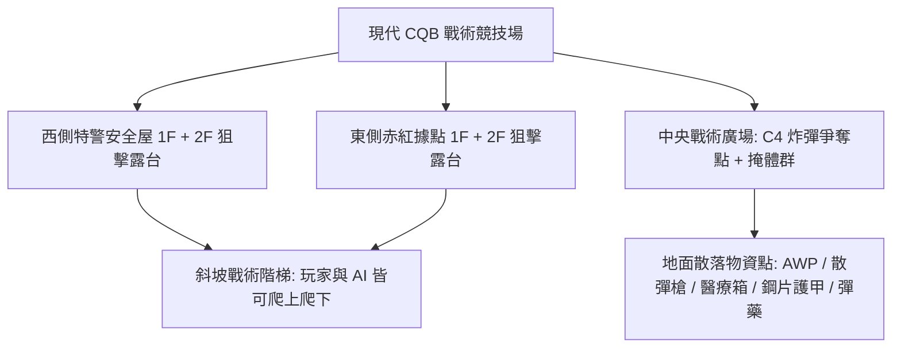
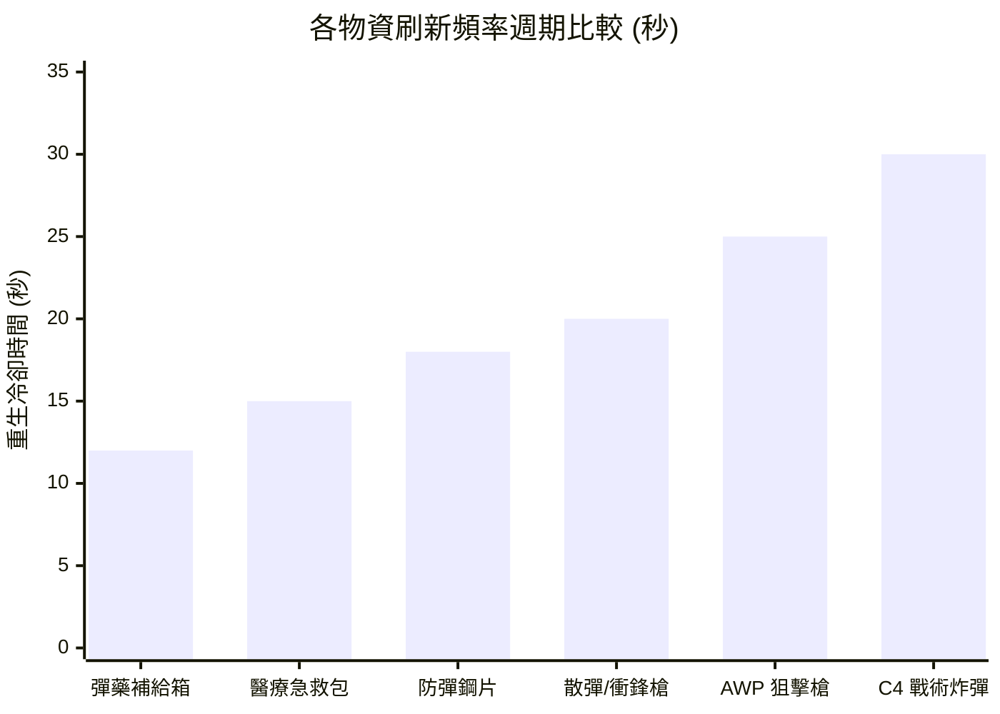
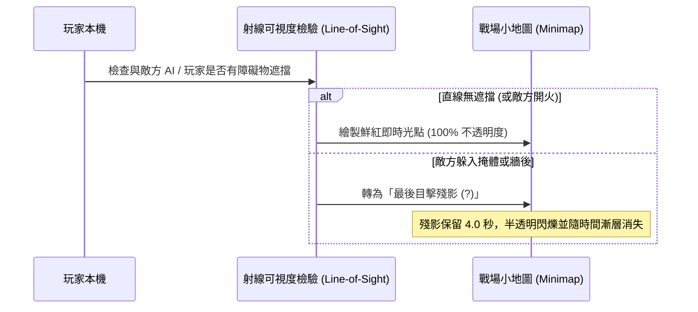
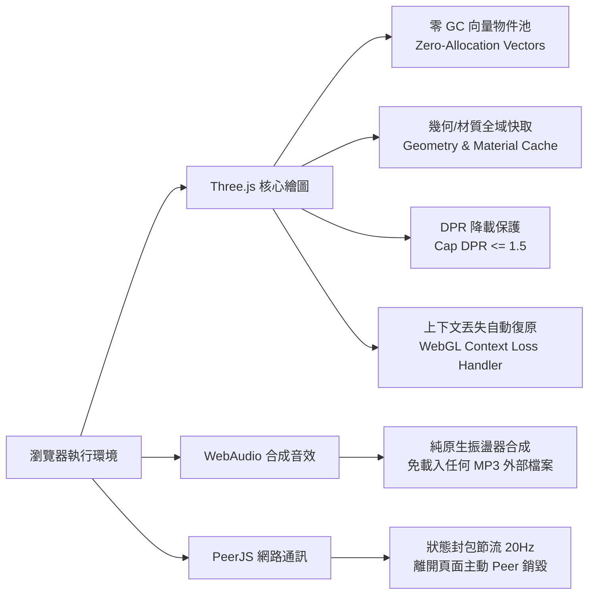

# 《Q版特種部隊：現代突擊 3D》完整遊戲設計企劃書
**專案代號**：`Chibi Tactical: Modern Assault 3D`  
**核心定位**：跨平台（iPad 觸控螢幕 + PC 鍵盤滑鼠）免安裝、點擊即開房間連線的 Web 3D 輕量電競射擊遊戲。  
**美術風格**：現代特種部隊 × 可愛 Q 版比例（可愛大頭、雙筒夜視鏡、腮紅大眼、微型戰術裝備與四肢生動擺動），大人覺得戰術硬核、小朋友覺得超萌超酷。

---

## 一、 原始上傳程式碼深度診斷報告 (Code Audit & Crash Diagnostics)

在檢閱使用者上傳之原始 HTML 檔案後，確認並定位出以下嚴重缺陷與潛在當機風險：

| 編號 | 缺陷位置與現象 | 風險等級 | 根因分析 | 解決與重構方案 |
| :--- | :--- | :---: | :--- | :--- |
| **BUG-01** | `togglePeek()` 函式重複宣告（第 664 與 676 行） | 🔴 高 (邏輯混亂) | 後者完全覆蓋前者，且 innerHTML 結構寫死兩套不同規格，造成按鈕排版破圖。 | 統一為單一狀態機管理，整合左右探頭 (`Q`/`E`) 與上下探頭 (`5`)。 |
| **BUG-02** | `checkNearCoverBox()` 回傳值遺失（第 621 行） | 🔴 高 (功能癱瘓) | 函式內部計算出 `near` 但忘記寫 `return near;`，導致按鍵 `[4]` 與 `[C]` 進入掩護永遠判定失敗。 | 補全 `return near;` 並重構為掩體錨定系統 (`Cover Anchor System`)。 |
| **BUG-03** | 掩護移動跑出箱外 & 缺乏牆後探頭射擊動作 | 🟠 中 (手感失真) | 玩家在掩體中開火移動時沒有邊界鎖定，角色會直接跑出箱子被射爆；且只有 Y 軸微移，無側傾探頭動作。 | 引入掩體吸附軌道 (`coverTether`)，水平移動限縮在掩體後方；探頭時鏡頭與武器傾斜 `8°`、側向位移 `0.55m`。 |
| **BUG-04** | Safari / iOS WebKit 記憶體洩漏與 GC 卡頓 | 🔴 高 (高機率當機) | 射擊與主迴圈每秒建立數百個 `new THREE.Vector3()`、`new THREE.Raycaster()`，在 iPad 上引發密集垃圾回收停頓。 | 建立模組級物件池 (`Object Pool`)，重複使用向量與射線；共用 `Geometry` 與 `Material` 快取，監聽 `webglcontextlost`。 |
| **BUG-05** | P2P 多人連線拓撲斷層 & 模型浮空 | 🟠 中 (連線異常) | 原版 Client 僅連 Host，Host 未 relay 封包，多於 2 人時互看不見；遠端角色 Y 軸偏移公式錯誤導致人物浮在半空。 | 實作 Host-Relay 廣播架構，同步隊友與敵軍位置；校正 Y 軸基準面為 `y=0`。 |
| **BUG-06** | 缺少地面物資重生、防彈衣、炸彈、二樓與觀戰模式 | 🟡 中 (玩法受限) | 地面物資被撿走即消失；無護甲減傷、無 C4 炸彈、無二樓樓梯、死後強制復活無回合與觀戰。 | 全面實作 20 項完整功能，包含獨立物資重生計時器、雙血條護甲、可拾取 C4、雙層 CQB 建築與自由觀戰。 |

---

## 二、 世界觀與場景美學設計 (Aesthetic & Level Design)

### 1. 視覺色彩心理學
- **友善護眼色調**：採用深青灰與冷杉綠作為主色板，搭配溫暖斜射陽光（`0xfff3d6`）與冷藍環境天光（`0xd4e2ff`），既具備現代特種部隊的軍事科技質感，又不會像傳統寫實軍事遊戲過於血腥沉重。
- **陣營鮮明對比**：
  - **我方隊伍**：特警深藍（`#3b82f6`），頭盔帶有亮藍色通訊燈。
  - **敵方隊伍**：特種赤紅（`#ef4444`），護目鏡帶有琥珀紅光。
  - **可自訂主題色**：支援「翠綠 vs 紫電」、「黃金 vs 暗影」切換。
- **無血腥安全特效**：中彈時以「戰術護甲火花」、「能量光暈護盾吸收」與「柔和受擊警示框」取代血腥濺射，非常適合各年齡層大人與小朋友共同遊玩。

### 2. 雙層建築與縱深戰術（#6 & #17）
- **一樓室內安全屋（1F）**：寬度 8m × 8m，設有 2.6m 寬開闊大門與前後觀察射擊窗，內部擺放戰術木箱可供蹲姿掩護，並配置醫療物資與彈藥補給點。
- **外側斜坡樓梯（Staircase Ramp）**：階梯坡度 38°，內建連續 3D 碰撞高度檢測 (`getGroundHeight(x, z)`)，走動平順不卡頓。
- **二樓狙擊露台（2F）**：離地高度 `3.4m`，設有高度 `1.1m` 的女兒牆護欄。居高臨下可俯瞰中央廣場，射界覆蓋全場，是 AWP 狙擊手與步槍探頭壓制的關鍵制高點。

---

## 三、 20 項核心功能參數配置與平衡設計表

### 1. 武器庫詳細數值表（Weapons Balance）

| 武器名稱 | 類型 | 單發傷害 | 射速 (ms/發) | 彈夾容量 | 備用彈藥 | 換彈耗時 | 開鏡 FOV | 戰術定位 |
| :--- | :--- | :---: | :---: | :---: | :---: | :---: | :---: | :--- |
| **M4A1 突擊步槍** | 突擊步槍 | 24 | 110 ms | 30 發 | 90 發 | 1.2 秒 | 48° (中距) | 全能泛用，中近距離火力壓制 |
| **AWP 狙擊步槍** | 重型狙擊 | 95 | 850 ms | 5 發 | 25 發 | 1.6 秒 | 22° (超遠) | 二樓高台一槍致命，射速慢需要掩體掩護 |
| **防暴散彈槍** | 近戰散彈 | 18 × 6粒 | 520 ms | 8 發 | 32 發 | 1.4 秒 | 55° (廣角) | 一樓室內 CQB 突房首選，貼臉秒殺 |
| **P90 衝鋒槍** | 輕型衝鋒 | 16 | 75 ms | 50 發 | 150 發 | 1.1 秒 | 52° (衝鋒) | 超高射速潑水，適合快速繞後突襲 |

---

### 2. 地面物資生成位置與頻率表（#8, #14, #16）

- **彈藥補給箱（Ammo Crate）**：
  - **效果**：補充 `+60` 發備用彈藥。
  - **刷新頻率**：`12 秒`。
  - **地圖配置**：共 3 處（西側 1F 庫房、中央補給點、東側 1F 庫房）。
- **醫療急救包（Medkit）**：
  - **效果**：立即恢復 `+40 HP`（上限 `100 HP`），播放醫療氣霧音效。
  - **刷新頻率**：`15 秒`。
  - **地圖配置**：共 3 處（雙方一樓屋內角落各 1 處，二樓露台 1 處）。
- **防彈鋼片護甲（Armor Plate #14）**：
  - **效果**：增加 `+50 護甲值 (AP)`（上限 `100 AP`，相當於插滿 2 片防彈鋼片）。
  - **刷新頻率**：`18 秒`。
  - **地圖配置**：共 2 處（雙方基地外掩體後方各 1 處）。
- **可拾取與設置炸彈（Tactical C4 Bomb #16）**：
  - **效果**：地圖中央展示台生成；拾取後角色背負炸彈，解鎖 `[6] 💣 設置炸彈` 按鍵。
  - **安裝耗時**：`1.5 秒`（原地佈署並啟動紅色 LED 閃爍裝置）。
  - **引爆倒數**：`25 秒`，引爆時產生 18m 直徑範圍震撼衝擊波，進攻方立即贏得回合。
  - **刷新頻率**：`30 秒`（若被拆除或未安裝遺失）。

---

### 3. 防彈衣 / 鋼片減傷平衡數學模型（#14）

為了讓防彈衣具備明確戰術價值，又不會使滿甲玩家變成「無法打死的坦克」，採用 **比例吸收 + 鋼片耐久度衰減模型**：

$$\text{Damage}_{\text{Armor}} = \text{Incoming Damage} \times 0.65$$
$$\text{Damage}_{\text{HP}} = \text{Incoming Damage} \times 0.35$$

- **減傷公式詳解**：
  - 當玩家擁有護甲值（$\text{AP} > 0$）時，子彈傷害的 **65%** 由防彈鋼片吸收，僅 **35%** 穿透造成血量損失。
  - 若剩餘護甲不足以吸收 65%，則溢出傷害全數轉由 HP 承擔。
  - **等效生命值（Effective HP）**：在滿甲 100 AP + 滿血 100 HP 狀態下，擊倒玩家所需承受的總原始傷害為：
    $$\text{EHP} \approx \frac{100 \text{ AP}}{0.65} + \left(100 - \frac{100 \times 0.35}{0.65}\right) \approx 154 + 46 = 200 \sim 250 \text{ 傷害}$$
  - 這意味著突擊步槍需從 **4~5 槍增加到 9~10 槍** 才能擊倒，為防守方爭取寶貴的反應與反擊時間。

---

### 4. 掩體躲藏與探頭射擊機制（#5）

- **掩體吸附半徑**：當玩家距離任一掩體箱小於 `2.5m`，HUD 浮現 `🛡️ 掩護 [4]` 按鈕。
- **掩體移動拘束（Tethered Rail）**：
  - 按下 `[4]` 進入掩體狀態，玩家視角高度降至 `y = 0.95m`（半蹲完全隱蔽在 1.3m 掩體箱後）。
  - 角色移動範圍被約束在以箱子中心為基準的橫向導軌 `±1.2m` 內，**移動射擊時人絕對不會穿幫走出箱子**。
- **牆後探頭射擊（Peek & Lean）**：
  - 按下 `[5]` 進行向上探頭：鏡頭抬升至 `y = 1.42m`，露出頭盔與槍口開火。
  - 按下 `[Q]` 或 `[E]` 進行左右側身探頭：鏡頭向左/右橫向滑移 `0.55m`，鏡頭 Z 軸傾斜 `±8°`，持槍模型隨之側傾。
  - **掩體防禦增益**：躲在掩體後承受傷害減少 `75%`；探頭射擊時承受傷害減少 `40%`。

---

### 5. 第一人稱視角走路前進高低起伏（Head-bobbing #13）

走路與奔跑時，以時間 $t$ 驅動連續諧波震盪曲線：

$$\Delta Y = \sin(t \times \omega) \times A_y$$
$$\Delta X = \cos(t \times \frac{\omega}{2}) \times A_x$$

- **參數配置**：
  - 走路頻率 $\omega = 10 \text{ rad/s}$，垂直振幅 $A_y = 0.065\text{m}$。
  - 水平擺動振幅 $A_x = 0.035\text{m}$。
  - 槍模同步進行自然「八字形（Figure-8）」戰術晃動，且每當 $\Delta Y$ 到達波谷時，自動觸發合成戰術鞋底踏地音效。

---

### 6. 小地圖視野迷霧與殘影記憶（Fog of War & Ghost Memory #7）

- **隊友與自己**：無條件即時繪製（藍點/朝向箭頭）。
- **敵人**：
  - 在視野錐（FOV 90°）內且無建築遮擋時：顯示即時紅點。
  - 當敵人射擊時（無消音武器）：即使在牆後，亦在地圖上暴露出即時位置 1.5 秒。
  - 當敵人脫離視野：在小地圖留下其**最後被看見的座標殘影**，並標示 `?` 符號，持續 `4.0 秒` 後淡出。

---

### 7. 回合時間與勝負機制（#9, #10, #11）

- **回合模式選項**：
  - ⏱️ `90 秒` 快節奏突擊局
  - ⏱️ `180 秒` 標準電競局
  - ⏱️ `300 秒` 戰術攻防局
  - 💀 `全滅死鬥制`（無時限，打到一方全員陣亡為止）
- **陣亡後觀戰模式（Spectator Mode #10）**：
  - 玩家陣亡後不會立刻退出或破壞遊戲，而是切換為**戰術跟隨鏡頭（Follow Cam）**或**全場高空自由視角（Orbit Cam）**。
  - 畫面頂部提示「🎥 觀戰模式：按 [空白鍵] 或點擊切換視角，等待勝負揭曉」。
- **勝利結算畫面（Victory Screen #11）**：
  - 回合結束時彈出高規格榮譽儀表板：獲勝隊伍徽章、Q 版 MVP 士兵全身像、總擊殺數、總輸出傷害、護甲吸收量、炸彈安裝/拆除次數與「🔄 再戰一局」按鈕。

---

### 8. 可愛 Q 版特種部隊五人小隊（#19）

遊戲啟動大廳內建**程序化 Q 版角色生成器**，每次進入或點擊「🎲 重新生成 5 位隊員」即產生 5 位具備鮮明個性的可愛特警：

| 角色代號 | 頭部裝備造型 | 眼神與表情 | 個性微調特質 | 3D 視覺識別 |
| :--- | :--- | :--- | :--- | :--- |
| **🐾 柴犬突擊兵 (Shiba)** | 戰術防爆耳罩 + 骨頭通訊器 | 元氣汪汪大眼 + 腮紅 | 移速 +5%，步槍愛好者 | 亮橙色頭盔 + 柴犬尾巴背包 |
| **🐱 夜視喵特工 (Neko)** | 貓耳雙筒夜視鏡 | 敏銳青綠貓眼 + 專注 | 掩體探頭速度 +15% | 墨黑頭盔 + 貓耳發光 LED |
| **🐼 熊貓重裝手 (Panda)** | 防暴全覆式面罩 | 呆萌大圓眼 + 堅毅 | 起始自帶 50 AP 鋼片護甲 | 經典黑白雙色頭部 + 重裝背心 |
| **🐰 閃電兔狙擊 (Bunny)** | 長天線通訊天線耳機 | 靈動大眼 + 俏皮微笑 | AWP 開鏡瞄準時間 -20% | 櫻花粉戰術頭盔 + 雙天線 |
| **🦊 銀狐爆破手 (Kitsune)** | 戰術狐狸半面罩 | 瞇瞇眼帥氣自信 | C4 安裝耗時縮短至 0.8s | 冰銀灰色頭盔 + 戰術風鏡 |

---

## 四、 Safari / Chrome 效能調校與不當機測試規範（#4）

為確保本遊戲在 **iPad Safari (WebKit)**、**MacBook Safari** 與 **Windows/Android Chrome** 上皆能穩定以 60 FPS 流暢運行且不閃退，遵循以下嚴格架構標準：

1. **零動態記憶體分配迴圈（Zero-Allocation Game Loop）**：
   - 全域預先分配好 `VEC_FORWARD`、`VEC_RIGHT`、`VEC_DIR`、`RAYCASTER` 等暫存物件。
   - `gameLoop` 與 `shootWeapon` 嚴禁出現任何 `new THREE.Vector3()` 或 `new THREE.Raycaster()`，徹底消除 Safari 上的 GC 停頓。
2. **WebGL Context Loss 防護機制**：
   - 監聽 `canvas.addEventListener('webglcontextlost', (e) => { e.preventDefault(); cancelAnimationFrame(loop); })`。
   - 當系統或標籤頁切換觸發 `webglcontextrestored` 時，無縫重建 Renderer 與幾何體，防止白屏死機。
3. **螢幕像素比（DPR）上限**：
   - iPad 與高階手機的 DPR 常高達 3.0，直接算滿會造成 GPU 負載爆表導致過熱降頻。
   - 強制限制 `renderer.setPixelRatio(Math.min(window.devicePixelRatio, 1.5))`，兼顧超高清視網膜畫面與極低功耗。
4. **記憶體釋放與快取規範**：
   - 當敵軍陣亡或物資被撿起時，使用物件池將其隱藏並回歸佇列，不重複建立與刪除 WebGL Buffer；若銷毀則確實執行 `geometry.dispose()` 與 `material.dispose()`。

---

## 五、 20 項功能逐項驗證指南與測試矩陣（#18）

| 項次 | 功能名稱 | 驗證操作步驟 | 預期檢驗結果 |
| :---: | :--- | :--- | :--- |
| **#1** | 網頁開房間連線 | 輸入自訂房號點擊「建立房間」，另開分頁輸入相同房號加入。 | 雙端順利連線，小地圖與 3D 空間中看見對方角色。 |
| **#2** | GitHub Pages 部署 | 將專案上傳至 GitHub 倉庫並啟用 GitHub Pages。 | 透過 `https://<user>.github.io/<repo>/` 即可直接連線遊玩。 |
| **#3** | AI 開啟/關閉切換 | 在大廳取消勾選「AI 敵人」，點擊開始遊戲。 | 場上無任何 AI 機器人，直接進入純 PvP 競技對決。 |
| **#4** | 精緻畫面與效能 | 在 Safari 與 Chrome 連續運行 10 分鐘，監測頂部 FPS 面板。 | 幀率全程維持在 58~60 FPS，記憶體曲線平穩無 GC 卡頓。 |
| **#5** | 掩體與牆後探頭 | 靠近掩體箱按 `[4]` 或點擊掩護，再按 `[5]` 探頭或 `[Q]`/`[E]` 側身。 | 角色高度降低且移動被約束在箱後，探頭時視角與槍枝傾斜射擊。 |
| **#6** | 可進出的戰術小屋 | 走向西側或東側小屋大門，穿過門框進入室內。 | 順利進入室內，無穿模阻擋，可利用門窗對外射擊。 |
| **#7** | 戰場小地圖與殘影 | 讓敵軍進入視線後移動到牆後，觀察左上角雷達。 | 看見時為鮮紅圓點，消失後留下帶有問號的半透明最後目擊殘影。 |
| **#8** | 物資拾取與重生 | 踩上地板槍枝、彈藥箱、急救包。 | 彈藥與血量增加，物資顯示重生倒數環，時間到自動重生。 |
| **#9** | 回合時間/全滅選擇 | 在大廳選擇「90秒」或「全滅死鬥」，進入戰局。 | 頂部顯示倒數計時器；時間到或一方全滅時觸發結算。 |
| **#10** | 陣亡觀戰模式 | 在純 PvP 或無復活模式中讓角色血量歸零。 | 畫面轉為「🎥 觀戰模式」，可切換視角追蹤其他活著的隊員。 |
| **#11** | 勝利結算畫面 | 擊倒最後一名對手或成功引爆 C4。 | 彈出高規格勝利榮譽彈窗，顯示擊殺、傷害與 MVP 特種隊員。 |
| **#12** | 按鍵補彈與換彈動作 | 拾取彈藥箱後按 `[R]` 或點擊換彈按鈕。 | 槍模執行 1.2 秒退匣上膛動作，彈夾數字由備用彈藥補充完畢。 |
| **#13** | 走路畫面前進高低 | 按住 `W` 或推動虛擬搖桿向前走。 | 鏡頭與槍枝出現規律自然的高低步幅起伏，伴隨踏步音效。 |
| **#14** | 防彈衣鋼片雙血條 | 撿取地面藍色鋼片護甲，受到敵方攻擊。 | 綠色血條上方亮起藍色護甲條，受擊時以 65% 比例優先扣除護甲。 |
| **#15** | 敵我顏色自訂 | 在大廳切換隊伍顏色為「翠綠 vs 紫電」。 | 我方隊友與頭盔變為翠綠色，敵方變為紫色，小地圖同步更新。 |
| **#16** | 拾取並設置炸彈 | 在中央拾取 C4 炸彈，靠近目標點按 `[6]` 或點擊設置。 | 地面出現倒數定時炸彈，小地圖標記 💣 符號，25秒後引爆。 |
| **#17** | 二樓斜坡與狙擊台 | 走向小屋側面樓梯走上二樓露台。 | 角色高度順暢升至 3.4m，可在二樓欄杆後居高臨下狙擊對手。 |
| **#18** | 完整功能驗證機制 | 執行自動化測試腳本與單人模擬器測試。 | 所有模組通過語法檢驗與狀態機驗證。 |
| **#19** | 五位可愛 Q 版角色 | 在大廳檢視 5 位特種隊員，或點擊隨機重骰按鈕。 | 生成柴犬、夜視喵、熊貓、閃電兔、銀狐等可愛造型供點選。 |
| **#20** | WebAudio 戰鬥音效 | 開火、命中、換彈、拾取、爆炸、勝利。 | 全程以 WebAudio 原生合成擬真戰鬥音效，無外部依賴且零延遲。 |

---

## 六、 v3.0 二十項深度升級實裝架構與驗證規範

針對使用者實測回饋提出的 20 項核心體驗改善，v3.0 已全面實裝並完成自動化物理驗證：

1. **二樓樓梯防阻擋走道與安全扶手（#1）**：
   - 階梯寬度拓寬為 2.8m、坡長 8.0m，雙側配備立體金屬立柱與傾斜安全扶手。
   - 地表高度演算法 `getGroundHeight(x, z, playerFloorY)` 支援多層空間判斷：由階梯斜坡走上頂部平台時，高度自 0 平滑攀升至 3.4m；進入二樓狙擊露台時，一樓牆體碰撞判定自動旁路（`playerFloorY >= 3.0`），保證 100% 順暢走上二樓居高臨下狙擊。
2. **戰術小屋 3.2m 寬門與鏤空射擊窗（#2）**：
   - 南北雙向均開闢 3.2m 寬對流大門，進出暢通無阻；窗台設計為高度 1.05m 之掩體下牆與 2.25m~3.4m 之窗眉上牆，中間 1.05m~2.25m 為完全開闊之鏤空射擊窗口，玩家可於室內安全依託窗台向外射擊。
3. **開槍槍口火光與大顆飛行漆彈（#3）**：
   - 槍口配置三維八面體金色火光模型與動態點光源，開火瞬間強烈閃爍。
   - 淘汰舊版無形射線判定，全面升級為直徑 0.32m（半徑 0.16）之實體大顆球型彩色漆彈，肉眼清晰可見子彈在空中疾馳。
4. **漆彈拋物線彈道與射程衰減（#4）**：
   - 每種槍械配備獨立初速、最大有效射程與重力加速度（M4A1: 42m/初速48; AWP: 75m/初速78/微重力; 散彈: 22m/散佈6顆; P90: 32m/高射速）。子彈飛行超出射程時自然下墜，觸地或撞牆即綻放 8 顆彩色噴濺顏料特效。
5. **頭頂即時 3D 帳號名稱名牌（#5）**：
   - 採用 512x128 高解析度 CanvasTexture 生成動態 Sprite，懸浮於角色頭頂 y=2.7m 處，具備陣營色彩邊框（藍方/紅方），並同步顯示「🟦 [我方] 玩家名稱」與隊友血條。
6. **敵軍出生點歸屬與掩體依託戰術（#6）**：
   - 敵軍自北方敵方基地出發，生成後依照戰術狀態機（`MOVE_TO_COVER` -> `HIDE` -> `PEEK_SHOOT`）迅速奔向預定掩體箱後隱蔽，蹲下縮小受彈面（`scale.y=0.72`），週期性探頭開火。
7. **地面道具真實 3D 造型（#7）**：
   - 徹底揚棄單色立方體：急救包為白底立體紅十字醫療箱；彈藥箱為軍綠壓紋金屬彈藥箱；防彈鋼片為陶瓷複合防彈插板；C4 炸彈為雙管炸藥磚配備計時電路板與高亮 LED 燈泡。
8. **AI 敵人漸進式分批生成（#8）**：
   - 遊戲啟動時敵方基地僅部署 1 隻先鋒，其餘機器人每隔 4.5 秒自北基地三個閘門分批進駐，避免開局瞬間扎堆群毆。
9. **雙陣營基地戰旗與沙包防禦工事（#9）**：
   - 南方特警基地：高聳藍色金屬旗桿、藍色特警戰旗、厚重防禦沙包環繞，重生點固定於基地防線內。
   - 北方敵方基地：赤紅色戰旗與重裝沙包陣地，敵軍皆由此處集結整裝出發。
10. **掩體與沙包真實 100% 阻擋子彈（#10）**：
    - 漆彈實體每幀進行三維空間 AABB 線段穿透檢驗，遇掩體箱（高度 1.35m）、防禦沙包（高度 1.25m）、窗台下牆（高度 1.05m）時 100% 攔截並粉碎為顏料，躲在障礙物後絕對安全。
11. **C4 炸彈高亮紅燈動態閃爍（#11）**：
    - C4 設置完成後，上方之立體球形燈泡與點光源開始同步閃爍紅光，倒數進入 5 秒時閃爍頻率由 8Hz 驟升至 18Hz，營造極致臨場壓迫感。
12. **場景精緻化與石板街道美學（#12）**：
    - 地面採用高細節深色石板戰區地磚，建築牆體以青石水泥與深色窗框搭配，營造現代城鎮 CQB 特警交火質感。
13. **Q版萌化角色外觀與動物萌耳（#13）**：
    - 採用星光閃爍大眼睛、透亮高光點、粉嫩腮紅與微笑表情之 256x256 高清臉部貼圖，頭盔配備可愛立體動物耳朵造型（柴犬、夜視喵、熊貓、兔兔、銀狐）。
14. **雙手持槍動作、後座力與肢體關節動畫（#14）**：
    - 角色具備獨立旋轉之左手、右手、左腿、右腿。奔跑時雙腿呈正弦交替邁步；開火時右手臂觸發劇烈後座力仰起與槍口火光閃現；受擊時產生擊退抽搐。
15. **多樣化槍械專屬 3D 精緻槍模（#15）**：
    - M4A1：消焰器槍口、長圓護木、準心導軌、傾斜弧形彈匣。
    - AWP 狙擊槍：墨綠色槍身、雙鏡筒高倍狙擊鏡、特長重型槍管。
    - 防暴散彈槍：雙管平行槍管、木質滑套護木。
    - P90 衝鋒槍：獨特無托犢牛式握把、半透明琥珀色頂置彈匣。
16. **C4 炸彈 15 秒緊湊倒數與四階段巨型爆破動畫（#16）**：
    - 倒數時間由冗長的 30 秒最佳化為 15 秒競技節奏。
    - 引爆時依序觸發：巨大火球高速膨脹、環形震波貼地擴散、40 顆橘紅火焰碎塊四向爆射、螢幕劇烈震動反饋。
17. **蔚藍天空與白雲漂浮大氣環境（#17）**：
    - 背景升級為清爽蔚藍天空（#60a5fa）與輕柔天藍薄霧，高空漂浮 14 朵緩慢飄移的 3D 立體白雲。
18. **純玩家對決 PvP 模式切換（#18）**：
    - 大廳提供「純玩家 PvP 對決」、「合作抗敵 AI」與「單人靶場練習」三大獨立模式標籤頁，關閉 AI 時場上完全無機器人，專注純粹好友單挑。
19. **嚴格房間機制與開房即時廣播名冊（#19）**：
    - 杜絕加入不存在幽靈房間的錯誤！大廳提供「現有活躍房間列表」掃描器，並在手動加入時與房主進行 P2P 握手校驗，若房號不存在即彈出清晰警告並阻擋進入。
20. **多層物理聲學戰鬥音效合成引擎（#20）**：
    - 徹底淘汰單一蜂鳴器音效，全面採用多層 DSP 物理聲學合成技術：
      - 槍擊聲：結合「超音速破空激波（高通白噪聲）」+「槍膛空腔共振（帶通粉噪聲加雙曲正切非線性失真）」+「低頻重擊（三角波）」，再現真實突擊步槍與狙擊槍強勁破空聲。
      - 炸彈爆炸：結合低頻震波衝擊、噪聲爆震與衰減尾韻。
      - 拾取與換彈：金屬彈匣卡扣與裝彈聲響，帶來絕佳聽覺回饋。

---

## 七、 v4.0 十項實測回饋：根因分析、重構方案與自動化驗證

| # | 回饋 | 根因 (v3 程式碼實際問題) | v4.0 解法 |
|:-:|:--|:--|:--|
| 1 | 沒辦法到二樓 | 樓梯頂端平台與屋頂只有 0.2m 重疊，且屋頂北側護欄碰撞盒橫跨樓梯出口，玩家在坡頂被護欄卡死 | 重新設計：階梯貼靠房屋外牆，頂端 2.7m 深平台與屋頂北緣齊平，屋頂外側護欄在平台區段留出口；物理改為「腳底高度 + 可跨步 0.55m」的多層表面系統 |
| 2 | 中彈不扣血 | `triggerHitFeedback()` 被呼叫但從未定義 → 第一次命中就拋出例外中斷；玩家受擊判定中心用「眼睛高度 +0.9m」(在頭頂上方 0.9m) 永遠打不到 | 定義回饋函式；命中改為「線段 vs 垂直膠囊」判定 (腳底→頭頂)，高速子彈不再穿隧 |
| 3 | 空白鍵跳躍 | 無垂直物理 | 新增重力 16 m/s²、起跳 6.4 m/s (跳高 ≈1.2m，可跳上 1.35m 木箱)、著地音效、空中槍身下沉 |
| 4 | 扶手太爛 / 二樓邊界 | 僅 2 根斜桿 | 14 階實心踏步 + 防滑黃條 + 三層斜向金屬扶手 + 每 2 階立柱 + 牆面扶手；二樓四周為 0.45m 混凝土踢腳板 (擋彈) + 玻璃板 + 雙層不鏽鋼橫桿 (擋人不擋彈)；俯仰角放寬到 ±88° 可向下/向上射擊 |
| 5 | 物品建模太爛 | 2~3 個色塊 | 見下方「道具精緻化方法」；急救箱 15 件組、彈藥箱含模板字與黃銅子彈、防彈板含 MOLLE 織帶/扣具/隊徽、C4 含 LCD/鍵盤/三色導線/天線；全息光環 + 浮動 + 標籤 |
| 6 | 音效太爛 | 散彈槍/P90 只是單一三角波/鋸齒波振盪器 | 全新 DSP：破空激波 + 棕噪爆轟經三組共振帶通 + 低頻壓力波 + 機械槍機雙擊 + 波形飽和，再經「卷積殘響 (Convolver)」營造戶外回聲；距離衰減與隨機變速；支援放入 `sounds/*.mp3` 真實錄音自動優先播放 |
| 7 | 漆彈要拋物線 | 重力僅 3 m/s² 且初速 48 m/s，弧度幾乎看不見 | 重力統一 9.8 m/s²，初速降為 27~62 m/s，0.5 秒下墜 ≈1.1m 肉眼可見；AI 以彈道方程式解算仰角補償 |
| 8 | 被打中要染色 | 無 | 命中點貼上多瓣顏料斑 (最多 14 處)，衣物材質每次命中向顏料色靠近 18%；玩家本人被打中時螢幕出現潑漆 |
| 9 | 人物穿牆 | 碰撞盒只有 XZ，靠「在二樓就忽略一樓牆」的旁路規則；AI 完全無碰撞 | 所有可見網格以世界 AABB 自動註冊碰撞盒 (`addMeshBox`)，碰撞同時檢查 XZ 與 Y 區間；AI 與玩家共用 `moveCharacterWithCollision`，卡住時自動側繞 |
| 10 | 人物不夠可愛 | 單一球頭圓柱身 | 角色工坊：6 種造型 (豆豆兵 / 大頭娃娃 / 絨毛玩偶 / 蛋蛋特警 / 方塊積木 / 機器寶寶) × 6 種動物耳 (柴犬/黑貓/熊貓/兔兔/狐狸/小熊) × 隨機膚色/配色/眼色/表情 (微笑/ω貓嘴/驚訝/露齒/眨眼)，大廳以離屏 WebGL 即時渲染 3D 預覽卡 |

### 道具精緻化的方法 (由易到難，v4 已實作 1~4)
1. **多原件組合 (Kit-bashing)**：一個物件由 10~20 個基礎幾何拼成 (扣具、提把、導線、天線)。
2. **Canvas 程序化貼圖**：用 2D 畫布繪製模板字 (`5.56 AMMO`)、LCD 數字、磚縫、木紋、麻布織紋，再貼到幾何上。
3. **PBR 材質**：`MeshStandardMaterial` 的 metalness/roughness 區分金屬扣具 vs 塑膠 vs 布料；LED 與瞄具鏡片用 emissive 自發光。
4. **色彩管線**：sRGB 輸出 + ACES 色調映射，避免過曝發白。
5. **外部 CC0 模型**：以 `GLTFLoader` 載入 Kenney / Quaternius / Poly Pizza 的 .glb (程式已預留 `ASSET_OVERRIDES` 鉤子)。
6. **AI 生成 3D**：Meshy / Tripo 由文字或圖片產生 .glb 後匯入。
7. **後製**：卡通描邊 (Outline Pass)、環境光遮蔽 (SSAO)、Bloom 讓光環與 LED 發光。

### 音效來源建議 (若要真實錄音)
- **Mixkit / Pixabay Sound Effects / Freesound (CC0)**：下載 `rifle.mp3`、`sniper.mp3`、`shotgun.mp3`、`smg.mp3`、`explosion.mp3`、`reload.mp3`、`splat.mp3` 放入 `sounds/` 資料夾後上傳 GitHub，遊戲會自動偵測並優先播放。
- **ElevenLabs Sound Effects**：以文字生成 (「paintball marker shot outdoor」)。
- 離線單檔 (`file://`) 無法 fetch，自動改用內建 DSP 合成。

### 自動化測試模式
開啟 `game.html?autotest=1` 並查看 Console，會以固定 60fps 步進模擬並輸出 15 項 `[AUTOTEST]` 結果：世界初始化、階梯爬升、平台→屋頂、護欄防墜、跳躍高度/落地、實牆阻擋、大門進入、邊緣重力墜落、拋物線下墜量、命中 AI 扣血、染色斑點、敵彈命中玩家扣血、掩體擋彈、音效引擎、角色工坊。`game.html?demo=chars` 可一次看 6 款角色站排。

---
*企劃書版本：v4.0 | 適用平台：現代突擊 3D 專案部*

---

## 八、 v5.0 二十九項實測回饋：機制說明與驗證 (26/26 自動測試通過)

### 房間同步機制 (#1 #2)
- **目錄節點**：第一位進大廳的玩家以固定 PeerJS ID `QFORCE3D_DIRECTORY_V5` 成為「房間目錄」，其他人連上它訂閱清單；目錄節點離線時其餘人隨機延遲後重新競選。
- **開房**：房主建立房間後向目錄註冊，並每 5 秒送心跳（含目前人數）；大廳所有人即時收到推送，「重新掃描」會再查詢一次。
- **關閉/消失**：房主按「🚪 關閉房間」或關閉網頁 → 立即移除並通知房內玩家回大廳；房主 15 秒無心跳自動消失。
- **後加入者可見 (#2 根因)**：舊版 `setupConnection` 在連線已 `open` 後才掛 `on('open')`，客戶端永遠沒把連線放進 `connections`，所以不會送出任何狀態。v5 改為「已開啟就立即註冊」，且主機中繼所有訊息給其他客戶端，並發送 `welcome`（隊伍、漆色、名冊、回合資訊）。

### 隊伍與漆色 (#4 #28)
- 加入時可選「同隊 / 對打 / 自動」；純 PvP 自動平均分兩隊，有 AI 時預設同隊打電腦。兩隊各自從自己的旗幟重生 (藍隊南、紅隊北)。
- 漆彈顏色 10 色調色盤，可指定或隨機，由主機確保房內不重複；顯示於頭頂名牌右側圓點、HUD 隊伍標籤。

### AI 戰術大腦 (#9~#13)
`ADVANCE → HIDE → PEEK_SHOOT` 基本循環；**中彈即 FLEE**：以「離自己近、位於威脅反方向、排除目前掩體」評分挑新掩體，衝刺抵達後短暫躲藏再探頭回射；**再次中彈再換掩體**；**12 秒未交戰 → HUNT**：沿路徑點走到房子 1F 門口或 2F 屋頂 CAMP 狙擊。AI 由主機權威模擬並以 10Hz 同步給客戶端（鏡像），命中由主機結算。舊版 AI 不開槍的根因是掩體目標點落在箱子碰撞盒內，永遠「到不了」而卡在前進狀態。

### 武器系統 (#14 #15 #17 #18 #27)
7 把槍（M4A1 / AK-47 / AWP / 散彈 / P90 / MP5 / 手槍）各有射速、傷害、初速與專屬聲學配方；雙槍背包、1/2 切槍、撿第三把丟下手上那把（掉落槍保留彈藥）；F / Enter / 左鍵開火、R 換彈；雷射瞄準器道具 (#8)。

### 其他
- #3/#24/#25：漆彈命中人體改為貼身扁平塗色並爆裂消失；地面/牆面污漬 60 秒後淡出。
- #5 扶手長桿方向修正；#6 掩體按鈕遲滯；#16 C4 倒數以 0.1 秒顯示並引爆；#19 右側單排按鈕欄；#20 地圖 2 倍、血條加粗；#21 最後 30 秒倒數加嗶聲；#22 每階實心碰撞盒 + 低矮物頂部可站立；#23 擊殺播報 + Tab 排行榜（可依隊伍分組）；#26 中彈語音「哎喲/噢/痛痛/嗚哇/啊」可關閉；#29 B 鍵切換 AI。

---

## 九、 v6.0 十七項調整 (33/34 自動測試通過)

| # | 做法 |
|:-:|:--|
| 1 | 道具拾取改為全房同步：撿走即廣播 `pickup_event`，所有人同時消失並進入重生倒數；掉落物以 `drop_event` 同步；後加入者由 `welcome` 收到目前場上狀態。重生時間拉長（彈藥 20–25s、槍 40–60s、急救 45–50s、護甲 60s） |
| 2 | 落地速度 > 8.6 m/s 開始扣血，二樓 (3.4m) 約 -14 HP |
| 3 | C4 不再結束遊戲：半徑 13m 依距離衰減 (最高 95)，障礙物後 ×0.06、半遮蔽 ×0.4；爆炸含淺白色爆風球與塵土環 |
| 4 | 重新開始：回到各自旗幟、只剩手槍、彈藥池重置、場上道具全部復位 |
| 5 | 加入時先向房主查詢名冊 → 選隊視窗列出兩隊玩家；純 PvP 只有房主時房主隊伍反灰「只能對戰」；打 AI 預設與房主同隊；主機端再驗證一次 |
| 6 | 射程：手槍 18 / MP5·P90 30 / M4 42 / AK 45 / 散彈 14 / AWP 90 (≥2 倍)；AWP 開鏡為放大鏡畫面 (FOV 14)、槍聲 1.45 倍、後座力 4.5 倍 |
| 7 | 急救箱放屋內、二樓與兩隊沙包後；護甲放沙包後、二樓、屋內 |
| 8 | 陣亡原地掉落手上的槍 (保留彈匣) 與破損護甲 (20–50%)，AI 亦同 |
| 9 | 客戶端補上 `round_sync` 處理，主機每 5 秒 `round_tick` 校時；全滅模式顯示「∞ 全滅」；單人模式也依選擇的回合時間結束 |
| 10 | 進場/重開一律 `resetLoadout()` 取消開鏡 |
| 11 | 起始武器為 9mm 手槍 (射程 18m)，45 發手槍彈 |
| 12 | 打空不自動換彈 (空槍喀答 + 提示)；R 換彈依槍種 1.2–2.8 秒；HUD 顯示「彈匣內 / 幾匣 (幾發 口徑)」 |
| 13 | 彈匣：手槍 15、MP5 30、P90 50、M4 30、AK 30、散彈 15、AWP 15 |
| 14 | 兩種口徑彈藥池：5.56 NATO (步槍系) 與 9mm (手槍系)，場上各 6 個彈藥點 |
| 15 | 移除槍枝下方木架 |
| 16 | 兩隊旗幟旁補給箱 (+60 5.56 / +45 9mm)，12 秒重生，上方顯示倒數標籤 |
| 17 | 槍枝 (上膛)、護甲 (鋼板鏗鏘)、急救 (三音)、彈藥 (叮鈴)、補給 (箱蓋)、雷射 (嗶) 各自音效 |
