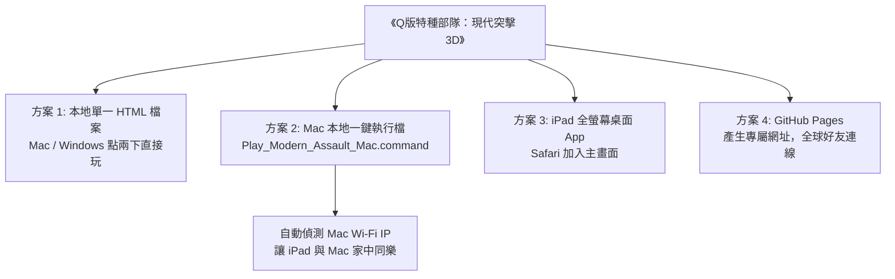
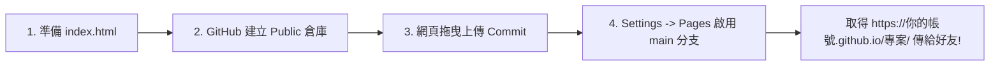

# 《Q版特種部隊：現代突擊 3D》本地執行檔與跨端遊玩完整說明書

這份說明書為你量身打造 **本機執行檔 (Mac / iPad / 瀏覽器)** 以及 **GitHub Pages 免費發布** 的多種極簡方案！

---

## 🌟 四大遊玩與執行方案一覽



---

## 方案 1：瀏覽器直接開（免裝任何軟體，點兩下直接玩）

我們已經將 **Three.js 3D 繪圖引擎、WebAudio 戰鬥音效、全部 20 項功能全部打包進單一 HTML 檔案**，檔案本身就是一個獨立的「網頁應用執行檔」！

### 操作步驟：
1. 下載側邊欄的 **`modern_assault_3d_game.html`**（或從介紹頁點擊「一鍵下載完整遊戲檔」存為 `index.html`）。
2. 在你的電腦（MacBook、iMac、Windows PC）上，**直接對該 `.html` 檔案連按兩下滑鼠**。
3. 你的預設瀏覽器（Google Chrome、Safari 或 Edge）會直接以 `file:///` 本地協定開啟 3D 遊戲，**完全不用連上外網，斷網也能玩！**
4. **本機雙人對戰測試小彩蛋**：  
   如果你在同一台電腦上用 Chrome 開啟 **兩個分頁**：
   - 第一個分頁輸入房號 `8888` 點擊「建立房間 (HOST)」。
   - 第二個分頁輸入房號 `8888` 點擊「加入 (JOIN)」。
   - 遊戲內建了 `BroadcastChannel` 本地通訊技術，**兩個分頁會在 0 秒內自動連線互打**，不用經過任何雲端伺服器！

---

## 方案 2：Mac 環境雙擊執行檔（區域網路伺服器 + iPad Wi-Fi 直連）

如果你希望在 Mac 上有一個「像一般應用程式一樣雙擊就開」的啟動器，並且希望讓家裡的 **iPad 或手機** 跟你的 Mac 在同一個客廳 Wi-Fi 下連線對戰：

### 執行檔位置：
在專案中的 **`scratch/web_game/Play_Modern_Assault_Mac.command`**

### 使用方式：
1. 將專案中的 `scratch/web_game` 資料夾下載到 Mac 的「下載」或「桌面」。
2. 直接 **連點兩下 `Play_Modern_Assault_Mac.command`**。
3. 腳本會自動完成以下動作：
   - 自動在 Mac 背景啟動輕量本地伺服器（Port 8080）。
   - 自動呼叫 Safari 或 Chrome 打開遊戲。
   - 自動抓取你 Mac 的 Wi-Fi 區域網路 IP（例如 `192.168.1.100`），並在終端機顯示：
     ```text
     📱 [iPad / 手機連線方式]：
        請在 iPad Safari 輸入：http://192.168.1.100:8080/game.html
     ```
4. **iPad 立刻連進來**：拿著 iPad 打開 Safari 輸入該網址，Mac 與 iPad 就能在家中 Wi-Fi 享受極速 0 延遲的多人 CQB 對戰！

---

## 方案 3：iPad 直接執行與安裝為全螢幕 App

遊戲程式已完整注入 **Apple Web App 專用標準協定**（支援觸控虛擬搖桿、雙指手勢、視角滑動瞄準）：

### 方式 A（最推薦：安裝成 iPad 桌面 App，無網址列全螢幕）：
1. 在 iPad 上用 Safari 打開遊戲網址（可以是 Mac 區域網路網址，或是 GitHub Pages 網址）。
2. 點擊 Safari 右上角（或下方）的 **「分享 (Share)」圖示**（一個向上的箭頭）。
3. 在選單中往下滑，點選 **「加入主畫面 (Add to Home Screen)」**。
4. 命名為「現代突擊 3D」，點擊「新增」。
5. 你的 iPad 桌面上就會出現一個**專屬特警圖標的 App**！點開就是完全去除瀏覽器網址列的**純淨全螢幕遊戲視窗**，體驗就跟 App Store 下載的原生遊戲一樣！

### 方式 B（透過 AirDrop 傳送 HTML 檔案）：
1. 在 Mac 上將單一自包含檔案 `modern_assault_3d_game.html` 透過 **AirDrop** 傳送到 iPad。
2. iPad 接收後選擇儲存至「檔案 (Files)」。
3. 在 iPad 的「檔案」App 中長按該檔案，選擇 **「分享」->「在 Chrome / Safari 中開啟」** 即可直接離線暢玩！

---

## 方案 4：上傳至 GitHub Pages（全球好友透過網址連線）

如果你希望將遊戲分享給遠方的朋友，只要 4 個步驟上傳 GitHub，全世界的人都能隨時連線：



1. **建立儲存庫**：在 [GitHub](https://github.com/) 點選 `+` -> `New repository`，輸入名稱（如 `chibi-assault`），務必勾選 **`Public`**。
2. **上傳檔案**：點擊 `Add file` -> `Upload files`，將 `scratch/web_game/` 下的 `index.html` 與 `game.html` 拖曳進網頁並點選 `Commit changes`。
3. **開啟 Pages**：點選倉庫頂部的 `Settings` -> 左側選單 `Pages` -> 在 `Branch` 下拉選單選擇 **`main`**，點擊 **`Save`**。
4. **取得網址開戰**：等候 1 分鐘後重新整理，即可取得 `https://<帳號>.github.io/<專案名稱>/` 網址！
   - 你建立房間 (HOST)，朋友輸入相同房號加入 (JOIN)，立即展開跨平台跨地域的 3D 特警激戰！

---

## 🎮 操作控制與鍵位一覽

| 動作類別 | 電腦 PC / Mac 鍵盤滑鼠 | iPad / 手機觸控螢幕 |
| :--- | :--- | :--- |
| **移動步伐** | `W`、`A`、`S`、`D` 鍵 | 螢幕左下方動態虛擬搖桿 |
| **旋轉視角 / 瞄準** | 移動滑鼠（支援指針鎖定與按住滑鼠拖曳） | 螢幕右半部滑動手指 |
| **射擊開火** | 滑鼠左鍵 | 螢幕右下角大面積「開火」按鈕 |
| **開鏡瞄準 (ADS)** | 滑鼠右鍵 或 數字鍵 `[1]` | 點擊「[1] 開鏡」按鈕 |
| **戰術換彈 (1.2s)** | 按鍵 `[R]` 或 數字鍵 `[2]` | 點擊「[2] 換彈」按鈕 |
| **半蹲蹲下** | 按鍵 `[C]` 或 數字鍵 `[3]` | 點擊「[3] 蹲下」按鈕 |
| **躲入掩體 (人不跑出)** | 靠近箱子按 `[4]` 或 `[C]` | 靠近箱子浮現「[4] 躲入掩體」按鈕 |
| **牆後探頭 / 側傾射擊** | 數字鍵 `[5]` (上探)、`[Q]` (左傾)、`[E]` (右傾) | 點擊「[5] 探頭射擊」按鈕 |
| **設置 C4 炸彈** | 撿到炸彈後按數字鍵 `[6]` | 撿到炸彈浮現「[6] 設置炸彈」按鈕 |
